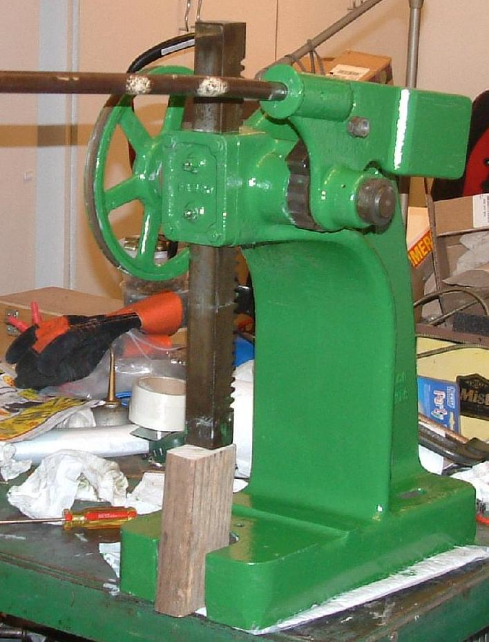

# Pressing In Bearings

!!! note "Coming soon"
    This page is still being written.

<!--
Installing bearings square without damaging them.

## When you need this

A **ball bearing** lets a shaft spin smoothly in a plate. It has an **outer race** (the outside ring), an **inner race** (the inside ring that the shaft goes through) and a row of steel balls between them. The most common FRC bearing is a flanged bearing with a 1.125" outside diameter and a 1/2" hex bore, often called an FR8 size. It sits in a hole in a gearbox plate or a tube, and a hex shaft slides through it.

You need this page when a bearing is going into a hole that's tight enough that it won't just drop in.

## Press fit vs slip fit

| Fit | What it means | How it goes in |
|---|---|---|
| **Slip fit** | The hole is a hair bigger than the bearing | By hand. It may need a light push. |
| **Press fit** | The hole is a hair smaller than the bearing, on purpose | With a press. The tight fit holds the bearing in place. |

The difference between them is a few thousandths of an inch, less than the thickness of a sheet of paper. Designers pick hole sizes for each. The CNC or 3D printer can make the hole a little bigger or smaller than planned, so the same bearing might slip in one plate and need a press in another.

The shaft usually slides through the inner race with a slip fit. A 1/2" hex shaft should slide through a hex bearing without force. If it doesn't, check the shaft for burrs before you push harder.

Thin or soft material (like 1/8" polycarbonate) can't hold a press fit well. AndyMark sells small aluminum bearing plates for that case.

## Tools

### Arbor press

An **arbor press** is a bench-mounted press. You pull a long handle, and a gear pushes a steel ram straight down with a lot of force. It's the best tool for bearings because it pushes straight and slowly, so you can feel when the bearing is seated.

### Bearing press tool

A **bearing driver** (or bearing press tool) is a disc or cup that sits between the ram and the bearing. It's sized to push only on the outer race. A bearing driver kit has a set of discs for different sizes.

If you don't have a driver that fits, use a **socket** from a socket set with an outside diameter just a little smaller than the bearing's outer race. It should touch the outer race and not the inner race or the seal.

A **bench vise** with soft jaws and a socket can work for a small bearing if there's no press nearby. Don't hammer a bearing in. NSK, a bearing maker, says hammering is only for small bearings with light fits when no press is available, and even then it's easy to damage them.

## Steps

1. **Check the hole.** Deburr the edge of the hole with a deburring tool so it doesn't shave the bearing. Wipe out chips.
2. **Check the bearing.** Spin it with your fingers. It should feel smooth. If it's gritty before you start, use a different one.
3. **Support the part.** Set the plate on the press table so the area right around the hole is supported. If it's a tube, make sure the press won't crush the tube walls.
4. **Start it square.** Set the bearing on the hole, flange up, and make sure it isn't tilted.
5. **Put the driver or socket on the outer race only.** This is the most important step. When you press a bearing into a hole, the outer race is the part with the tight fit, so that's where the force goes.
6. **Press slowly.** Pull the handle smoothly. If the bearing starts to tilt, stop, back off, and straighten it.
7. **Stop when it seats.** You'll feel the force jump when the flange touches the plate. Don't keep pushing.
8. **Spin it again.** It should still feel smooth. If it feels notchy or rough now, it was damaged during pressing. Replace it.

!!! warning
    Never press on the inner race, the seal or the shield when pressing a bearing into a hole. The force goes through the balls, and they dent the races. That's called **brinelling**. The bearing will feel rough or notchy and wear out fast, even if it looks fine.

## Removing a bearing

1. Support the plate on the press table with a gap under the bearing (a socket or a tube bigger than the bearing works well).
2. From the other side, put a driver or socket on the **outer race**, sized to fit through the hole.
3. Press it out slowly.
4. Spin the removed bearing. If you pushed on the inner race or it feels rough, throw it away. Bearings are cheap compared to a gearbox that fails.

A flanged bearing can only come out the way it went in, pushed from the side without the flange.

!!! question "2928: fill in"
    Do we have an arbor press and a bearing driver set, and where are they? Which hole sizes do we use in CAD for slip fit and press fit FR8 bearings on our router and printers?

!!! tip "Photo needed"
    A photo of a socket sitting on the outer race of a flanged bearing in our arbor press, ready to press. Ideally a second photo showing the wrong way (socket on the inner race) marked with an X.

## Common mistakes

- Pressing on the inner race.
- Hammering bearings in.
- Starting the bearing tilted and pushing harder when it jams.
- Not supporting the plate, so it bends instead of the bearing going in.
- Pressing past the point where the flange is seated.
- Reusing a bearing that was pressed out through the inner race.
- Forcing a hex shaft through a bearing that has a burr in it.

## Learn more

- [NSK: Bearing mounting](https://www.nsk.com/am-en/tools-resources/bearings/maintenance/bearing-mounting/), how a bearing maker says to press bearings
- [Wikipedia: Brinelling](https://en.wikipedia.org/wiki/Brinelling), what happens when force goes through the balls
- [AndyMark: 1.125 in. Bearing Plate](https://www.andymark.com/products/1-125-in-bearing-plate), for mounting FR8 bearings in thin material
-->
