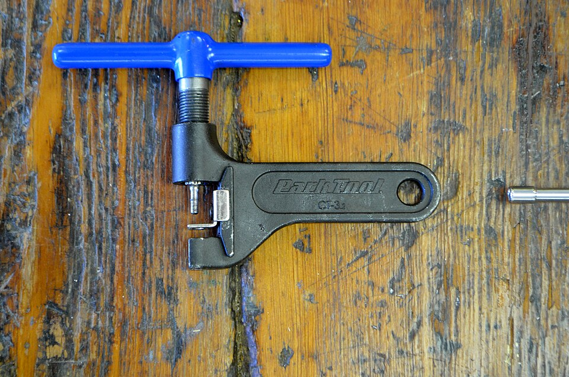
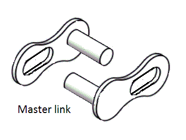

# Chain Assembly and Disassembly

!!! note "Coming soon"
    This page is still being written.

<!--
Breaking, joining and tensioning roller chain.

## When you need this

**Roller chain** is the same kind of chain as on a bike: a loop of links that wraps around two or more **sprockets** (toothed wheels) to carry power from a motor to a wheel, arm or intake. You'll work with chain when you build a mechanism, when you shorten or replace a chain, and when a chain gets loose or jumps off at competition.

Some words you'll see:

- **Pitch**: the distance from one pin to the next.
- **Pin**: the steel rod through each joint.
- **Inner link**: two plates with rollers between them.
- **Outer link**: two plates pressed onto the pins. Chain alternates inner, outer, inner, outer.
- **Center distance**: the distance between the centers of two sprockets.

## Chain sizes we use

FRC teams mostly use two sizes. The number tells you the pitch in eighths of an inch.

| Chain | Pitch | Working load (WCP) | Typical use |
|---|---|---|---|
| #25 | 1/4" | 154 lb | Intakes, conveyors, turrets, light mechanisms |
| #25H (heavy) | 1/4" | 209 lb | Same as #25, plus small-wheel drivetrains and elevators |
| #35 | 3/8" | 419 lb | Drivetrains with 6" or larger wheels, arms, wrists |

Working loads are from WCP's [sprockets and chain page](https://docs.wcproducts.com/frc-build-system/belts-chain-and-gears/sprockets-and-chain). #25 and #35 don't fit each other's sprockets or tools.

!!! question "2928: fill in"
    Which chain sizes are on this year's robot, and on which mechanisms?

## Breaking chain

A **chain breaker** (chain tool) is a small press. You set a link in it and turn a screw, and a steel pin pushes the chain's pin out. You need one sized for the chain: a #25 tool for #25 and a #35 tool for #35. (The tool in the photo is a bicycle chain tool. FRC chain tools look different but work the same way.)

1. **Figure out the length.** Count links on the CAD model or wrap the chain around the sprockets. Plan to end with one inner link and one outer link so the ends can join. If you need an odd number of links, you'll need a half link.
2. **Set the chain in the tool** with the pin you want to push lined up exactly with the tool's pin.
3. **Clamp the chain** if the tool has a clamp screw, so it can't shift.
4. **Turn the screw slowly** to push the pin. It takes real force, then it suddenly gets easier as the pin moves.
5. **Stop before the pin comes all the way out** if you want to rejoin the chain with that same pin. Leave the pin sticking into the far outer plate. REV's instructions say to stop before the pin leaves the back plate and to check often. A pin that falls out is very hard to get back in.
6. If you're using a master link instead, push the pin all the way out.
7. Back the tool off and pull the link apart.

## Master links vs pressed links

There are two ways to close a loop of chain.

**Master link** (connecting link): an outer link with two pins fixed to one plate, a loose second plate, and a spring clip that holds it together. It goes on and off by hand with pliers.

**Pressed link**: you use the chain tool to push the original pin back through the inner link and into the far plate, the way the chain came from the factory.

| | Master link | Pressed link |
|---|---|---|
| Speed | Fast, no tool needed | Needs the chain tool |
| Strength | Weaker. The clip can come off. | REV says a re-pressed pin is stronger than a master link. |
| Good for | Quick repairs at competition, chain you remove often | Final assembly of chain you won't take off |

When you install a master link:

1. Push the master link's pins through the two inner links at the ends of the chain.
2. Put the loose side plate on.
3. Slide the clip on so it snaps into the grooves on both pins. Use needle-nose pliers.
4. Point the closed (rounded) end of the clip the same way the chain moves most of the time. That way, if it catches on something, it's pushed closed instead of open.

REV notes master links can be reused many times but bend with use. Throw away a bent one.

When you press a pin back in, push until the pin sticks out the same amount on both sides as its neighbors. Then flex that joint with your fingers. If it's stiff, it's pressed too tight. Flex it back and forth, or press the pin a tiny bit the other way until it moves as freely as the others.

## Tensioning

Chain stretches as it wears. A loose chain skips teeth or falls off. A chain that's too tight adds friction, loads the bearings, and wears everything faster. WCP describes the target as just enough slack for smooth rotation while the chain stays engaged.

Ways to tension chain:

- **Exact center distance.** The designer places the sprockets so the chain fits snugly. Works when everything is built accurately, but there's no adjustment once the chain stretches.
- **Slotted holes or sliding bearing blocks.** One sprocket's bearing block slides in a slot. Push it to tighten the chain, then tighten the bolts.
- **Cam tensioners.** A round cam with an off-center hole holds the bearing. Rotate the cam to move the shaft.
- **Idler sprocket.** An extra sprocket on its own shaft pushes against the chain to take up slack. It doesn't change the gear ratio.
- **Inline tensioner (turnbuckle).** A small device that goes into the chain itself, using the chain pins, and shortens the loop when you turn it. WCP and AndyMark sell these. They only work on a straight stretch of chain that never wraps around a sprocket. AndyMark's #35 version needs about 3" of chain that never touches a sprocket.

To check tension, push the middle of the longest straight span sideways with a finger. It should move a little and spring back. Spin the mechanism by hand through a full loop. If it gets tight at one spot, the sprockets may be bent or out of line.

!!! tip "Photo needed"
    Close-ups from our shop: a #25 chain in our chain breaker with the pin half pushed out, and an installed master link with the clip pointing the right way.

## Common mistakes

- Pushing the pin all the way out when you meant to re-press it.
- Pressing a pin back in too tight, leaving one stiff link that bounces and wears.
- Putting the master link clip on backward or not fully in both grooves.
- Mixing #25 and #25H chain or sprockets without checking they match.
- Cranking the chain tight "so it won't fall off."
- Sprockets that aren't lined up, so the chain rides on the side of the teeth.
- Forgetting safety glasses. Pins and clips fly when they let go.

## Learn more

- [WCP: Sprockets and Chain](https://docs.wcproducts.com/frc-build-system/belts-chain-and-gears/sprockets-and-chain), chain sizes, loads, center distance and tensioning
- [REV: Chain Tool](https://docs.revrobotics.com/ion-build/motion/sprockets-and-chain/chain-tool), step by step use of a #25 chain breaker
- [gm0: Roller Chain](https://game-manual-0.readthedocs.io/en/stable/docs/power-transmission/chain.html), a good beginner explanation from the FTC community
- [AndyMark: #35 Inline Chain Tensioner](https://andymark.com/products/35-inline-chain-tensioner)
-->
