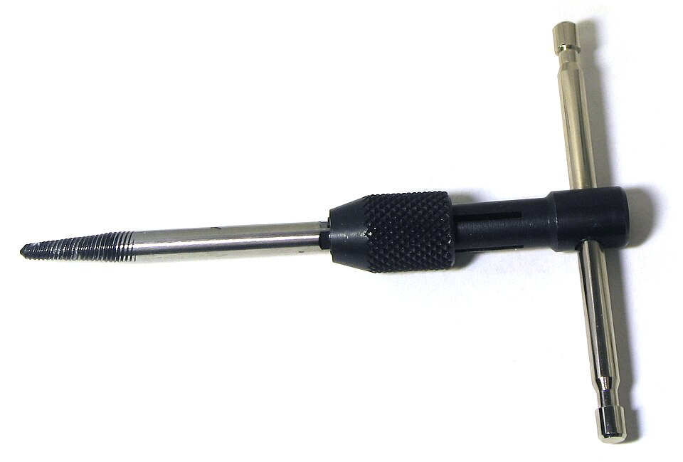

# Stripped Screws

!!! note "Coming soon"
    This page is still being written.

<!--
Preventing stripped heads and getting them out when it happens.

## When you need this

A **stripped** screw is one where the hex socket in the head has been rounded out, so the key just spins. (People also say "stripped" when the threads in the hole are ruined. That's covered in [Avoiding Cross-Threading](cross-threading.md).)

This happens a lot on FRC robots because #10-32 **button head** screws are everywhere, and their 1/8" hex socket is small and shallow. A stripped screw in a swerve module at competition can mean pulling the module and missing a match. Most of the time you can prevent it.

## Preventing stripping

### Use the right bit, fully seated

- **Use the exact size.** 1/8" for a #10 button head, 5/32" for a #10 socket head. A 3 mm key is close to 1/8" and will strip the head.
- **Push the key all the way into the socket.** If it's only halfway in, all the force goes on the top edge of the socket.
- **Clean out the socket.** Paint, metal chips or dried Loctite in the socket keep the key from seating. Pick it out with a scribe.
- **Use the straight end** for the final tightening and for breaking a screw loose. Ball ends slip. See [Tools We Use](tools.md).
- **Throw away worn bits and keys.** A rounded key strips good screws.
- **Push in while you turn.** Keep the key straight in line with the screw.

### Button head vs socket head

| Head | Looks like | Hex size (#10) | Strips | Use it when |
|---|---|---|---|---|
| Button head (BHCS) | Low, rounded dome | 1/8" | More easily, the socket is shallow | You need a low profile, or the head has to clear something |
| Socket head (SHCS) | Tall cylinder | 5/32" | Less easily, deeper and bigger socket | You need to torque it hard, or remove it often |
| Torx (star) button head | Low dome with a six-point star socket | Depends on size | Much less, the star shape grips better | You remove it a lot and want a low profile |

If the same button head keeps stripping, ask whether a socket head or a Torx head fits there instead.

### Threadlocker (Loctite)

**Threadlocker** is a liquid you put on the threads before assembly. It hardens and keeps the screw from vibrating loose. The color tells you how strong it is.

| Type | Strength | Remove with | Use it for |
|---|---|---|---|
| Purple (Loctite 222) | Low | Hand tools | Small screws (#4, #6) that would break with stronger stuff |
| Blue (Loctite 242 or 243) | Medium | Hand tools | Most robot bolts. 243 tolerates a little oil on the parts. |
| Red (Loctite 263 or 271) | High | Heat, then tools | Almost never on a robot. It's meant for things you never take apart. |

Red threadlocker is one of the top causes of stripped screws on FRC robots. Someone used it, and now nobody can get the screw out without stripping it. REV's MAXSwerve guide tells teams to use blue 242 and avoid red. SDS's MK4i guide says to use 242/243 on its bolts.

Use a small drop on the threads, not the head. Too much gets into the socket and dries there.

!!! question "2928: fill in"
    Which threadlockers do we stock (242, 243, 222, Vibra-Tite)? Is red allowed anywhere on our robot?

## Removing a stripped screw

Try these in order, from least damage to most. Wear safety glasses for all of them, especially cutting and drilling.

If the screw has red Loctite, heat it first. Hold a soldering iron on the screw head for a minute or use a heat gun on the area. Keep heat away from plastic parts, wires and bearings with rubber seals.

### Bigger or Torx bit

1. Try a slightly bigger hex key or a metric one that's a little larger (3.5 mm or 9/64" in a stripped 1/8" socket).
2. If that spins too, find a **Torx bit** that's just slightly too big to fit in the socket.
3. Tap the Torx bit into the socket with a small hammer. The star points cut into the soft rounded corners.
4. Turn it out slowly with a hand driver while pushing down hard.
5. Throw the screw away. The Torx bit may be dull afterward too.

A wide rubber band over the screw head, under the key, sometimes gives enough grip for a slightly stripped screw.

### Screw extractor

A **screw extractor** is a hardened bit with a reverse (left-hand) spiral. You drill a small hole in the screw head, then turn the extractor counterclockwise. As it digs in, it grips harder and turns the screw out.

1. Center punch the middle of the screw head so the drill doesn't wander.
2. Drill a pilot hole the size the extractor kit says. Some kits have a drill bit on one end of the extractor. Go slow.
3. Put the extractor in the hole and turn it **counterclockwise** with a tap wrench or the kit's driver. Use steady force.
4. When the screw starts turning, keep going until it's out.

!!! warning
    Extractors are hard and brittle. If you force one, it can snap off inside the screw, and a broken extractor is much harder to remove than a stripped screw. If it doesn't move with firm hand pressure, stop and ask a mentor.

### Cutting a slot

1. Use a rotary tool (Dremel) with a thin cutoff wheel.
2. Cut a straight slot across the screw head, about as deep as the head is wide. Don't cut into the part.
3. Turn the screw out with a flathead screwdriver that fills the slot.

On a button head that sticks up, you can also grab the outside of the head with **locking pliers** and turn it out.

### Last resort

Drill the head off with a drill bit about the size of the screw's body, lift the part off, then grab the leftover stud with locking pliers. Ask a mentor before you do this on anything expensive.

## Common mistakes

- Using a 3 mm key on a 1/8" socket.
- Torquing with the ball end.
- Driving screws in with a drill on high speed.
- Using red Loctite "so it never comes loose."
- Using too much Loctite so it fills the socket.
- Keeping a stripped screw "for now." Replace it as soon as it's out.
- Forcing an extractor until it snaps.

## Learn more

- [VEX: Removing stripped screws](https://kb.vex.com/hc/en-us/articles/360035953051-Removing-V5-Stripped-Screws) shows the cut-a-slot method step by step.
- [REV: MAXSwerve tips and tricks](https://docs.revrobotics.com/ion-build/motion/maxswerve/maxswerve-tips-and-tricks) has REV's threadlocker advice.
- [Raider Robotics 4698: Mechanical guide](https://teamguide.pages.dev/Mechanical) covers threadlocker colors.
- [gm0: Tips and Tricks](https://game-manual-0.readthedocs.io/en/latest/docs/hardware-basics/tips-and-tricks.html)
-->
