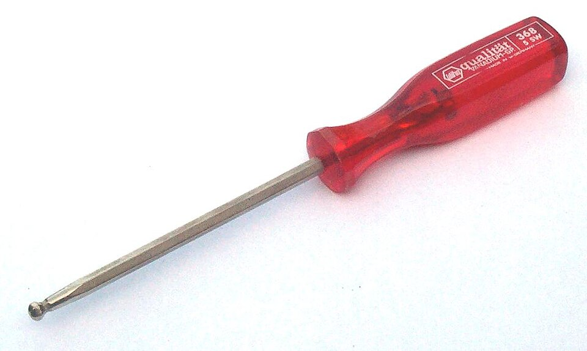
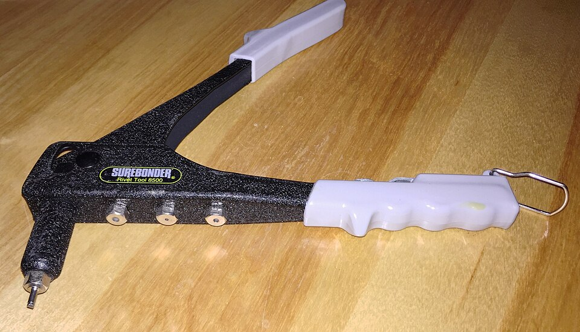

# Tools We Use

!!! note "Coming soon"
    This page is still being written.

<!--
The hand tools in the shop and what each one is for.

## When you need this

Read this before you build or fix anything on the robot. Most damage in the pit comes from using the wrong tool: a worn hex key that strips a screw, a pair of pliers used as a wrench, or a drill used to drive a bolt the whole way in. Picking the right tool takes five seconds and saves an hour of drilling out a ruined screw.

## Hex keys and drivers

Almost every bolt on an FRC robot has a hex socket, a six-sided hole in the head. You turn it with a **hex key** (also called an Allen key or Allen wrench). FRC robots use inch (SAE) sizes almost everywhere, so grab the inch set unless you know the part is metric. A metric key that is "close enough" will strip the screw.

The sizes you will use most:

| Screw | Head style | Hex size |
|---|---|---|
| #10-32 | Button head (BHCS) | 1/8" |
| #10-32 | Socket head (SHCS) | 5/32" |
| 1/4-20 | Button head (BHCS) | 5/32" |
| 1/4-20 | Socket head (SHCS) | 3/16" |
| #8-32 | Button head (BHCS) | 3/32" |

#10-32 is the most common bolt on most FRC robots. The first number is the size (#10), and the second is threads per inch (32). WCP's [tools page](https://docs.wcproducts.com/welcome/frc-build-system/system-standards/tools) lists the 1/8" and 5/32" drivers for #10 button and socket heads.

### Ball-end vs straight

A **ball-end** hex key has a rounded tip. It lets you turn a screw when the key is tilted up to about 25 degrees off the screw's axis, which helps when a gusset or motor is in the way. The tradeoff is grip. The ball only touches the screw at a few small points, so it slips and strips heads if you crank on it.

- Use the ball end to spin a screw in or out quickly.
- Use the **straight end** (or a straight driver) for the last tight turn and for breaking a tight screw loose.
- Throw away ball-end keys with rounded or twisted balls. The FTC guide gm0 points out that ball-end drivers wear out faster than straight ones.

### T-handles and screwdriver-style drivers

A **T-handle** is a hex key with a T-shaped grip. You can spin it fast with your fingers and get good torque with your palm. Most of the time on the robot you'll use a T-handle or a screwdriver-style hex driver instead of an L-key.

**Hex bits** in a drill or impact driver are fine for running a screw most of the way in. Stop before it seats and finish by hand or with a [torque wrench](torque-wrench.md). A drill can strip a #10 head or snap a small screw before you feel anything.

## Wrenches and sockets

You need a wrench to hold the **nut** on the other side of a bolt while you turn the head.

- **Combination wrench**: open on one end, a closed ring on the other. A 3/8" wrench fits #10-32 nylock nuts and 3/8" hex shaft. Use the closed end when you can. It grips all six sides and won't round the nut.
- **Ratcheting wrench**: a combination wrench whose ring end ratchets, so you don't have to lift it off the nut each turn. Great in tight spots.
- **Socket and ratchet**: a socket is a short tube that grips a nut, and it snaps onto a ratchet handle. Use them for bigger nuts and when you need more force.
- **Adjustable wrench**: a fallback. It slips more than a fixed wrench, so don't use it on small nuts.

!!! tip
    A 1/4" drive socket that fits over a #10 nylock nut works with most small torque wrenches too.

## Rivet tools

A **POP rivet** (blind rivet) is a hollow aluminum tube with a steel pin (the mandrel) through it. You put it in a hole, squeeze the **rivet tool**, and the tool pulls the mandrel until the back of the rivet swells and the mandrel snaps off. Teams use rivets to hold gussets onto box tube because they are fast, light, and don't vibrate loose.

1. Pick a rivet with the right diameter for the hole and a grip range that matches the total thickness of the parts.
2. Push the mandrel into the tool's nosepiece. Use the nosepiece that matches the rivet size.
3. Put the rivet in the hole and hold the tool square to the part.
4. Squeeze the handles several times until the mandrel snaps.
5. Dump the spent mandrel into the trash, not on the floor or into the robot.

To remove a rivet, drill out the head with a bit the same size as the rivet body. Don't drill bigger than that, or you'll make the hole oversized.

## Pliers and cutters

| Tool | Use it for | Don't use it for |
|---|---|---|
| Needle-nose pliers | Holding small nuts, pulling cotter pins, reaching into tight spaces | Turning bolts (they round the corners) |
| Flush cutters | Cutting zip ties flush so there's no sharp tail | Cutting steel wire or screws |
| Diagonal cutters (dikes) | Cutting wire and thicker zip ties | Anything hardened, like a drill bit or steel pin |
| Locking pliers (Vise-Grips) | Gripping a stripped or rounded fastener so you can remove it | Normal tightening |
| Wire strippers | Electrical work (see the Electrical section) | Cutting bolts |

Cut zip ties with flush cutters. The sharp tail left by dikes or scissors slices hands and wires.

## Where tools live

Put a tool back the moment you finish with it. A missing 1/8" T-handle at a competition can cost a match.

!!! question "2928: fill in"
    Where do tools live in our shop and in the pit? Are drawers or shadow boards labeled? Which tools travel to competition, and who packs them? Do we have ball-end and straight sets of each size?

## Common mistakes

- Using a metric key on an inch screw (or the reverse). 3 mm and 1/8" are close enough to slip, not close enough to grip.
- Torquing down with the ball end of a hex key.
- Keeping a worn hex key. If the corners are rounded, toss it.
- Driving a screw all the way in with a drill.
- Turning nuts with pliers.
- Leaving zip-tie tails long or sharp.
- Leaving rivet mandrels inside the robot, where they can short electronics.

For safety rules (eye protection, power tools) see [Safety](../general/safety.md).

## Learn more

- [WCP: Tools](https://docs.wcproducts.com/welcome/frc-build-system/system-standards/tools), the drivers and keys WCP recommends for #10 and 1/4" hardware
- [gm0: Tips and Tricks](https://game-manual-0.readthedocs.io/en/latest/docs/hardware-basics/tips-and-tricks.html), short shop tips from the FTC community, many of which apply to FRC
- [FIRST: Bolt Sizes Table (PDF)](https://www.firstinspires.org/hubfs/lms/frc-guided-experience/m4/bolt-sizes-table-pdf.pdf?hsLang=en)
-->
