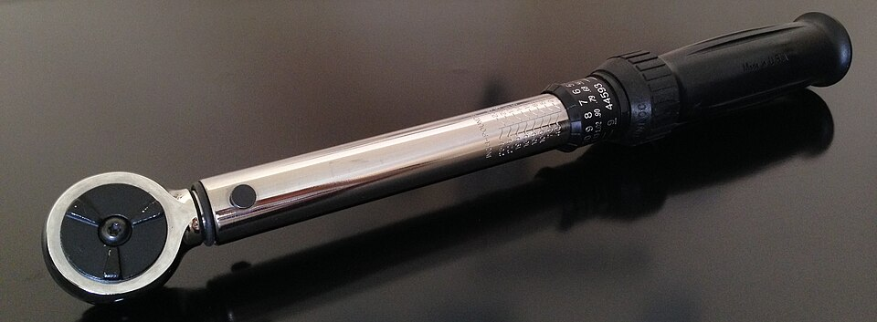

# Torque Wrench

!!! note "Coming soon"
    This page is still being written.

<!--
Tightening bolts to the right torque, not just "tight."

## When you need this

**Torque** is how hard you twist a bolt. It's measured in inch-pounds (in-lb) or newton-meters (N·m). One N·m is about 8.85 in-lb.

Most bolts on an FRC robot go into aluminum. Aluminum threads are soft. If you crank a #10-32 bolt into a tapped aluminum plate as hard as you can, you'll pull the threads out of the hole before the bolt breaks. If you go too light, the bolt backs out from vibration, and a bolt that backs out of a swerve module can lock a wheel mid-match. A torque wrench takes the guessing out.

Use a torque wrench on:

- Drivetrain and swerve module bolts
- Gearbox bolts
- Anything the vendor gives a torque spec for (motor terminals, for example)
- Any bolt you're going to [torque stripe](torque-striping.md)

## Types of torque wrench

| Type | How it tells you to stop | Good for | Watch out for |
|---|---|---|---|
| **Click** | The head "breaks" with a click when you hit the set torque | General use. Most shops have one. | Easy to miss the click at low settings. Must be stored at its lowest setting. |
| **Beam** | A pointer moves along a scale while you pull | Cheap, never needs calibration springs | You have to read the scale while pulling, often at an awkward angle. |
| **Digital** | Beeps, vibrates or lights up at the target | Easy to read, often switch between units | Needs batteries. |
| **Preset / torque-limiting driver** | Slips or clicks at one fixed value | Small screws, motor terminals, fast pit repairs | Only one value (or a small range). Works in the tightening direction only. |

A **torque-limiting driver** looks like a screwdriver. When you hit the set torque, the handle slips or clicks and stops turning the bit. WCP sells preset ones at 0.6 N·m for CAN terminals, 0.9 N·m for power terminals and 2.5 N·m for #10-32 bolts ([WCP tools](https://docs.wcproducts.com/welcome/frc-build-system/system-standards/tools)). These are great for the pit because nobody has to set anything.

## Torque values

Always use the vendor's number first. Swerve modules, gearboxes and motors often list a torque spec or a threadlocker in their assembly guide. When there's a vendor spec, it wins over any chart, including ours.

When there's no vendor spec, there's no single correct number for a #10-32 bolt. It depends on the bolt material, whether it goes into a nut or tapped aluminum, how deep the threads are, and whether there's threadlocker on it. Some reference points:

| Source | Fastener | Value |
|---|---|---|
| WCP preset torque wrench | #10-32 | 2.5 N·m (about 22 in-lb) |
| WCP preset torque wrench | Kraken power terminals | 0.9 N·m (about 8 in-lb) |
| WCP preset torque wrench | Kraken CAN terminals | 0.6 N·m (about 5 in-lb) |

General torque charts give much higher numbers for steel bolts into steel nuts. Those numbers will strip a tapped aluminum hole, so don't use a general chart without checking with a mentor. A rule many charts repeat is that a bolt threaded into aluminum needs about two bolt-diameters of thread engagement, or its torque should be reduced a lot.

!!! question "2928: fill in"
    What torque values does 2928 use? Suggested table: #8-32, #10-32 and 1/4-20, each into a nylock nut and into tapped aluminum. Also: which torque wrenches and preset drivers do we own, what are their ranges, and where are they kept?

## Steps

These steps are for a click-type wrench. For a preset driver, skip to step 4.

1. **Check the units.** Many wrenches have an in-lb scale and a N·m scale. Make sure you're reading the one that matches your spec.
2. **Set the torque.** Unlock the handle (many have a locking knob or a pull-out collar), then twist it until the main scale and the handle scale add up to your number. Lock it.
3. **Pick the right range.** A wrench is least accurate near the bottom of its range. If you need 20 in-lb, use a small wrench (something like 10-80 in-lb), not a 20-150 ft-lb car wrench.
4. **Run the bolt in first.** Spin the bolt in by hand or with a T-handle until it's snug. The torque wrench is for the last bit of tightening, not for spinning a bolt down.
5. **Pull smoothly.** Hold the wrench by the center of its handle and pull slowly and steadily at a right angle to the wrench. Don't jerk it.
6. **Stop at the click.** One click is enough. Don't click it again and again. That keeps adding torque.
7. **Stripe it** if it's a bolt we check between matches. See [Torque Striping](torque-striping.md).

!!! warning
    Never use a click torque wrench to loosen a bolt, and don't use it as a regular ratchet. Breaking a stuck bolt free can go past the wrench's maximum and wreck its accuracy. Park Tool's guide calls this out.

## Storing it

A click wrench has a spring inside. Leaving it set high keeps that spring squeezed, and over time it starts clicking at the wrong torque.

1. When you're done, wind the handle down to the **lowest number on the scale**. Not zero, and not past the bottom stop.
2. Put it back in its case.
3. Don't drop it or use it as a hammer. A dropped wrench should be checked before anyone trusts it.

Park Tool recommends calibrating click and limiter wrenches about every 5,000 clicks, or at least once a year if you use them a lot. Preset drivers don't need to be wound down.

!!! question "2928: fill in"
    Who checks or sends out our torque wrenches for calibration, and how often?

## Common mistakes

- Reading the N·m scale when the spec is in in-lb (or the reverse). That's a factor of almost 9.
- Using a big automotive wrench for small #10 bolts.
- Clicking the wrench three or four times "to be sure."
- Using the torque wrench to loosen a bolt.
- Leaving it cranked up when putting it away.
- Torquing a bolt that's cross-threaded. The wrench will click, but the joint is still bad. See [Avoiding Cross-Threading](cross-threading.md).
- Tightening before the threadlocker is on, then backing it out to add some.

## Learn more

- [Park Tool: Torque Wrench Use and Care](https://www.parktool.com/en-int/blog/repair-help/torque-wrench-use-and-care) covers click, beam and limiter types, storage and calibration.
- [WCP: Tools](https://docs.wcproducts.com/welcome/frc-build-system/system-standards/tools) lists WCP's preset torque wrenches and their values.
- [CDI: Bolt Torque Specifications](https://jmtest.com/TorqueFacts-BoltTorqueSpecs/) is a general chart from a torque wrench maker. Read the notes before using it on aluminum.
-->
