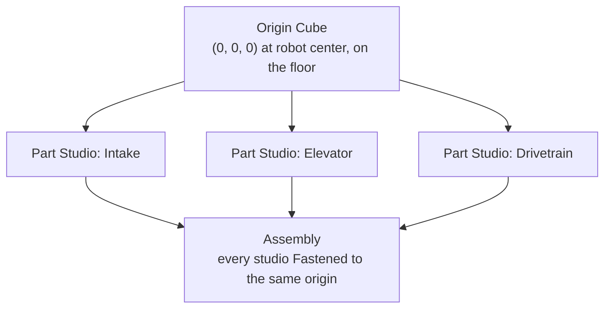

# Rule 1: One Origin for Everything

**The rule:** Every Part Studio and every Assembly uses the same robot coordinate system, the center of the robot on the floor, created with Origin Cube. Origin Cube is the first thing you add to every Part Studio, and every part is modeled where it actually sits on the robot.

## What it means

The **origin** is the point (0, 0, 0) that Onshape measures everything from. On our robot it's the center of the robot at floor level, in every document.

**Origin Cube** is the FeatureScript that sets this up. It drops a small reference cube, hanging just below the floor, so the cube never overlaps the robot. The cube gives every document the same thing to attach to.

That means:

- Origin Cube is the **first feature** in the feature list of every Part Studio, before any sketch.
- Parts are **modeled in place**. If the intake sits 10 inches behind the front bumper and 6 inches above the floor, the model puts it exactly there. You don't build it at the origin and move it later.
- Every Assembly starts from the same origin, so inserted parts land in the right spot without extra mating.

| Direction | Meaning |
|---|---|
| Z | Up from the floor |
| X | Toward the front of the robot |
| Y | Toward the robot's left |

This is the same frame WPILib uses in robot code (+X forward, +Y left, +Z up), so the CAD and the code agree on where things are, and the model can go straight into tools like AdvantageScope.

That puts each standard plane in a fixed place on the robot:

| Plane | What you see when you sketch on it |
|---|---|
| Top | The robot from above |
| Front | The robot's side profile, length and height |
| Right | The robot's front or back, width and height |

!!! warning "The view cube doesn't match the robot"
    Onshape names its views as if the model's front faces you along −Y. Our robot's front faces +X, so the view cube buttons are off by a quarter turn:

    - **Front** shows the robot's **right side**.
    - **Right** shows the robot's **front**.
    - **Back** shows the robot's **left side**, and **Left** shows the robot's **back**.

    Onshape doesn't let you relabel the cube, so we accept the mismatch to keep the CAD in the same frame as the robot code. Go by the axes, not the button names.

## Why

- **Parts line up by themselves.** Two people who never talked can model an intake and an elevator, and they meet in the right place in the assembly.
- **Other people can reference your geometry.** A sketch or part in one studio can be used in another and it will still be in the right place.
- **Coordinates are real measurements.** A point at Z = 12 in is 12 inches off the floor. The distance from the origin tells you the robot's height, half its width and half its length without measuring.
- **Fewer broken mates.** Parts that are modeled in place don't need to be moved and re-mated when something changes.
- **It supports other rules.** Master sketches ([Rule 3](03-master-sketches.md)) and function-driven dimensions ([Rule 5](05-smart-dimensions.md)) both depend on everyone sharing one origin.

## How

1. **Make or open a Part Studio.** Use the tab name that fits the mechanism, such as "Intake".
2. **Add Origin Cube first.** Open the custom features dropdown at the right end of the toolbar, or press S, and choose Origin Cube. If you haven't installed it yet, see [Getting Started](../getting-started.md).
3. **Keep the constants and functions on.** Origin Cube imports hole-size variables and power train functions through its All variables and All functions options, which are on by default. Leave them on, because Rule 5 depends on them. Leave the origin object as Cube and the origin location as Top, so the cube hangs below the floor with its top face on it, and leave the mate connector on so you can attach to the origin in assemblies. Origin Cube warns you if it isn't the first feature.
4. **Check the feature list.** Origin Cube must be at the very top. If something is above it, drag Origin Cube above it. Nothing should be above it except the Origin and standard planes.
5. **Sketch on the standard planes, at real positions.** Use Top, Front and Right planes, and place sketches and extrudes where the part really goes. If a part needs to be offset from a plane, dimension the sketch from the origin, or use a plane built from the origin.
6. **In an Assembly, start at the origin.** Insert each Part Studio and attach its origin to the Assembly origin with a Fastened mate. Because the parts were modeled in place, they land where they belong with no further positioning.
7. **Test it.** Click on the floor point under the robot. Its coordinates should read (0, 0, 0). Pick a part you know the height of and measure from the origin to check the number.

!!! note "Screenshots and video to add"
    - The feature list of a Part Studio with Origin Cube at the top.
    - The Origin Cube options dialog with the constants and functions option on.
    - An Assembly showing every Part Studio fastened to the origin.

### Common mistakes

- Building a part at the origin and moving it into place later.
- Adding sketches before Origin Cube.
- Making a second origin or custom plane at the robot center. Use Origin Cube's.
- Putting the origin on the part itself instead of at robot center.

### More to read

- [Slides on why the origin is the robot center on the carpet](https://docs.google.com/presentation/d/1DXBhbZE0sR7pGe2a-DUtgLQuQARwKNZHtNHRgSB99xo/htmlpresent), including the reference cube idea.
- [Origin Cube on FRCDesign.org](https://frcdesign.org/resources/featurescripts/)

**Next:** [Rule 2: Branching](02-branching.md)
