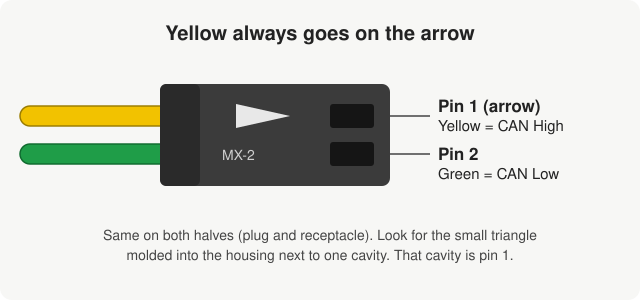
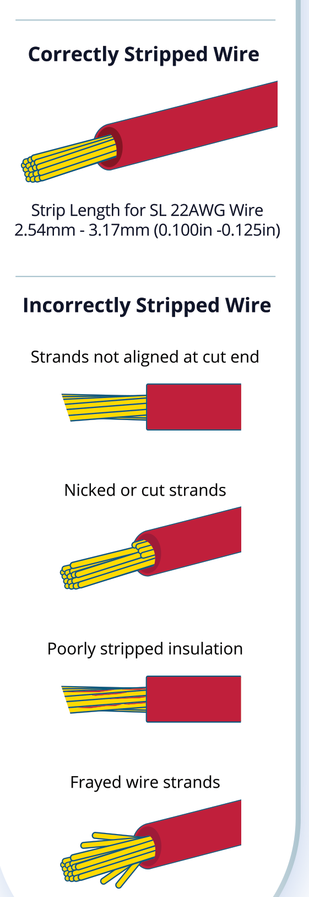
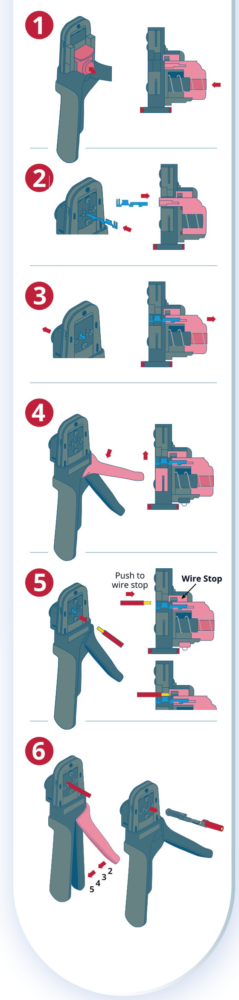
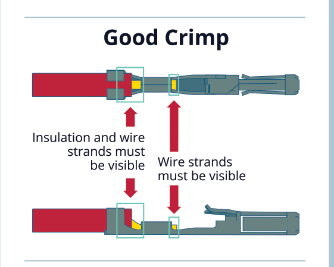
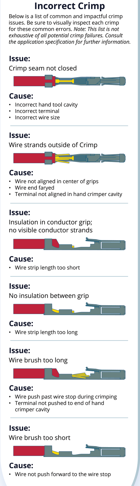
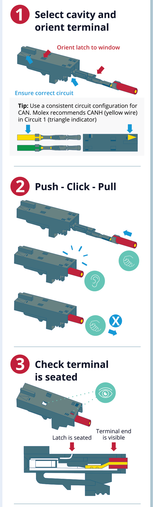
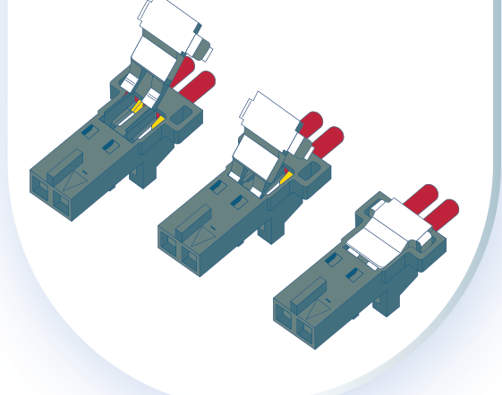
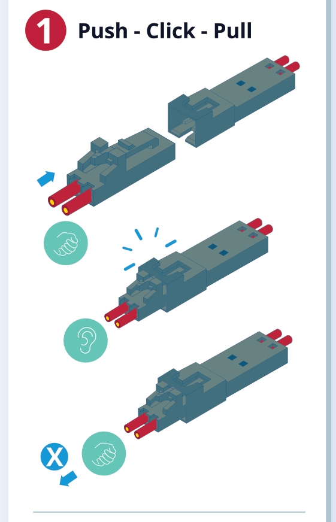

# Crimping CAN Connectors (Molex SL)

How to put a Molex SL connector on a CAN wire so it never drops out mid-match.

## When you need this

Any time you make or repair a CAN cable. CAN is the network that carries every command from the robot controller to the motor controllers, so it's the most important wiring on the robot. One bad CAN crimp can take out every device after it on the chain.

Take your time with these. A CAN crimp that "probably looks fine" isn't good enough.

## Why Molex SL

There are a lot of ways to connect CAN wire. We use **Molex SL**, a small two-pin connector with a locking latch, for a few reasons:

- **The latch.** The two halves click together and can't vibrate apart. The old Dupont-style pins (the kind on PWM cables) just friction-fit and pull out easily, so don't use them for CAN.
- **It's becoming the standard.** Two-pin Molex SL is what Limelight chose for the CAN ports on Systemcore, and for the Powerpole adapter boards used with Kraken motors. Using it everywhere means any of our cables can plug into any of our devices.
- **It can be locked even more.** A small add-on clip called a TPA (explained below) locks the terminals into the housing.

## The pinout

Every Molex SL housing has a small **triangle (arrow) molded into the plastic** next to one of its two cavities. That cavity is **pin 1**.

| Pin | Wire | Signal |
|---|---|---|
| 1 (arrow) | Yellow | CAN High |
| 2 | Green | CAN Low |

**Yellow always goes on the arrow.** That's true for both halves of the connector, and it matches Systemcore and the Powerpole adapter boards. If every cable on the robot follows it, you can swap a motor without rewiring anything.

A connector with yellow and green swapped will still click together. It just won't work, and it can take hours to find. Check the arrow every single time.

## Parts

These are the parts we stock for CAN. If a part in the bin doesn't have one of these numbers on the bag, don't use it for CAN.

| Part | Part number | Notes |
|---|---|---|
| Socket terminal, gold, 22–24 AWG | Molex 16-02-0103 | Goes in the receptacle housing |
| Pin terminal, gold, 22–24 AWG | Molex 16-02-0115 | Goes in the plug housing |
| Receptacle housing, 2-pin | Molex 50-57-9702 | Holds socket terminals. Has the latch. |
| Plug housing, 2-pin | Molex 70107-5002 | Holds pin terminals |
| TPA insert, 2-pin | Molex 73838-0002 | Locks the terminals into the housing. The same part fits both the receptacle and the plug, so every housing gets one. |
| CAN wire | Thrifty Bot TTB-0384 | 22 AWG twisted pair, yellow and green |
| CAN terminator | SWYFT CANender, Molex SL version | A 120 Ω resistor in a Molex SL connector. Plugs into the last device on a bus. See [termination](control-system.md#wiring-order-and-termination). |

If you ever order more, order these exact part numbers. Similar-looking SL parts exist that don't fit the TPA, or that are tin plated.

### Gold, not tin

SL terminals come in two platings: **tin** (silver colored) and **gold**. Use gold.

- **Gold lasts longer.** Tin SL terminals are rated for 25 plug-in cycles and gold for 50. 
- **Don't mix them.** When a tin terminal mates with a gold one, tiny bits of tin rub off onto the gold, and the two metals corrode each other over time. Systemcore and many newer devices use gold, so a tin cable plugged into them wears out their connectors too.

### TPA

A **TPA (Terminal Position Assurance)** is a small plastic insert that snaps into the side of the housing after the terminals are in. It holds each terminal in place from behind, and it only goes in if every terminal is fully seated, so it doubles as a check.

Without a TPA, a terminal is held only by its own little metal tab, at about 17.5 N (4 lb) of pull. With the TPA, it holds over 50 N (11 lb). Terminals slowly backing out of their housings are a common cause of CAN dropouts, and the TPA stops that. **Every CAN housing gets a TPA.**

The TPA is one-time use. Once it's snapped in, plan on using a new one if you take it out.

!!! note "What about CPAs?"
    You may see a second clip called a **CPA (Connector Position Assurance)**. It locks the latch after two halves are plugged together. A connector that passes the push, click, pull check (step 7 below) is already held firmly, so we don't use them.

## Tools

| Tool | Notes |
|---|---|
| Molex crimper **63811-8700** | Made for SL terminals. Has a 22–24 AWG nest and a 32–36 AWG nest. FIRST has historically offered it through FIRST Choice. |
| Wire stripper with a length stop | A stop makes every strip the same length. Strip length is the most common problem with SL crimps. |
| Flush cutters | For a square cut before stripping |
| Small flat screwdriver | For pushing terminals fully into the housing (see below) |
| Multimeter | For checking the finished cable |

Use the Molex crimper. Generic "open barrel" crimpers can work with a positioning jig, but they're much easier to get wrong, and the crimp specs on this page only apply to Molex terminals in Molex tooling.

!!! tip "Photo needed"
    Close-up of our Molex 63811-8700 with a terminal sitting in the 22–24 AWG nest, so students can see which nest and which way the terminal faces.

## Steps

### 1. Check the wire

The 63811-8700 crimps 22 to 24 AWG wire with an insulation diameter of 1.09 to 1.65 mm. Most FRC CAN wire is 22 AWG. 22 AWG is also the biggest wire SL is designed for, and wire with extra-thick insulation will bind in the housing so the terminal can't click in. If a new spool of wire looks fatter than usual, measure it with calipers before you make a robot's worth of cables.

### 2. Strip

<figure markdown="span" class="side-figure">
  
</figure>

1. Cut the wire end square with flush cutters.
2. Strip **2.5 to 3.2 mm (0.100 to 0.125 in, about 1/8 in)** of insulation.
3. Look at the strands. If any are cut or nicked, cut the end off and strip again.
4. Give the strands a light twist so none stick out.

Strip only one wire at a time and crimp it right away, so the strands don't get bent or splayed while they wait.

### 3. Crimp

<figure markdown="span" class="side-figure">
  
</figure>

1. Squeeze the crimper until the ratchet releases and the jaws open fully.
2. Find the **22–24 AWG nest**.
3. Lift the locator and set the terminal in the nest with the open crimp tabs facing up into the die and the terminal resting against the locator. Let the locator go so it holds the terminal.
4. Push the stripped wire in from the back until the strand tips touch the **wire stop**, the small metal blade at the front of the nest. The insulation should sit in the rear (insulation) tabs and the bare copper in the front (conductor) tabs.
5. Hold the wire against the wire stop (don't push past it), then squeeze the crimper all the way. The ratchet won't let go until the crimp is complete. Don't force it open early.
6. Take the terminal out and inspect it before you do anything else.

### 4. Inspect the crimp

This is the step that matters most. Look at every crimp under good light. A magnifier or a phone camera zoomed in helps a lot.

<figure markdown="span">
  { width="420" }
</figure>

A **good** crimp has all of these:

- **Conductor crimp on bare copper only.** The front tabs are wrapped tightly around the strands with no insulation caught under them.
- **Insulation crimp on insulation.** The rear tabs grip the insulation firmly. They can dent it slightly, but they shouldn't cut through it.
- **Copper and insulation both visible in the window,** the gap between the two crimps. If you only see insulation there, the insulation went into the conductor crimp. If you only see copper, the insulation crimp isn't holding anything.
- **A brush** at the front: the strand tips are flush with the end of the conductor crimp or stick out up to about 1 mm (1/32 in). If you can't see the strand tips, you can't tell the wire went all the way in.
- **A bell mouth:** a small flare at the back edge of the conductor crimp. It keeps the barrel's edge from cutting into the strands.
- **A straight, clean terminal.** The contact end (the part that mates with the other connector) isn't bent, dented or twisted, and has no strands in it.

**Reject** the crimp and redo it if:

- Insulation is under the conductor crimp.
- Strands are poking out the sides, or a strand is folded back.
- Strands reach into the contact area.
- The terminal is bent, or the contact area is squashed.
- The insulation is cut through or crushed.
- The wire moves at all when you hold the terminal and gently wiggle the wire.

### What went wrong?

Most bad crimps come from a handful of mistakes. If you're making the same bad crimp twice, find it here:

| What you see | Usual cause |
|---|---|
| Crimp seam not closed (tabs don't fully wrap the wire) | Wrong nest on the crimper, wrong terminal, or wrong wire size |
| Strands sticking out the sides of the crimp | Wire not centered in the tabs, frayed wire end, or terminal not sitting straight in the nest |
| Insulation in the conductor crimp, no copper visible | Strip length too short |
| No insulation in the window, only copper | Strip length too long |
| Brush too long (strands far past the crimp) | Wire pushed past the wire stop, or terminal not pushed all the way into the nest |
| No brush (strand tips not visible) | Wire not pushed forward to the wire stop |

??? example "Drawings of each bad crimp"
    <figure markdown="span">
      { width="460" }
    </figure>

Then give it a **tug test.** Hold the terminal and pull the wire gently, like pulling a charger out of a wall. You don't need to pull as hard as you can, just enough to know it's secure.

SL terminals are cheap and redoing a crimp takes a minute. Finding a bad CAN crimp on the field can take a whole event. When in doubt, cut it off and do it again.

!!! tip "Photo needed"
    Close-up photos through a magnifier of one good SL crimp and a few bad ones (insulation in the conductor crimp, no brush, stray strand, bent terminal). Keep the bad samples in a labeled bag as a reference board.

### 5. Put the terminals in the housing

<figure markdown="span" class="side-figure">
  
</figure>

1. Check the pinout: **yellow goes in the cavity with the arrow.**
2. Turn the terminal so its small springy metal tab (the latch) faces the **window**, the little square opening on the top of the housing above that cavity.
3. **Push, click, pull.** Push the terminal straight in until you hear or feel it click. Then pull back gently on the wire. It shouldn't move.
4. If the insulation binds and the terminal won't click, push on the back of the terminal through the TPA opening in the side of the housing with a small screwdriver or use the molex insertion tool.
5. **Check it's seated.** Look through the window. You should see the latch sitting in the window and the end of the terminal visible. If you can't, it isn't all the way in.
6. Snap the **TPA** into the side of the housing. If it won't go in all the way, a terminal isn't fully seated. Don't force the TPA. Find the terminal that's sticking out and use the inserstion tool to fully seat it without kinking the wire.

<figure markdown="span" style="clear:both">
  { width="380" }
  <figcaption>Installing the TPA.</figcaption>
</figure>

If you put a terminal in the wrong cavity, ask a mentor before you try to pull it out. Removing a seated SL terminal means releasing its metal tab without bending it. It's often faster to cut the wire and crimp new terminals.

### 6. Test the cable

Before it goes on the robot:

1. With a multimeter on continuity (beep) mode, check yellow end-to-end and green end-to-end. Both should beep.
2. Check yellow to green. It should **not** beep. If it does, there's a short.
3. Wiggle the wires near each connector while you test. If the beep cuts in and out, a crimp is loose.

### 7. Plug it in

<figure markdown="span" class="side-figure">
  
</figure>

Connecting two halves uses the same **push, click, pull**:

1. Line up the two halves and push them together.
2. Listen and feel for the latch **click**.
3. **Pull** on the two housings (not the wires). They shouldn't come apart.

No click means no latch, and an unlatched CAN connector will eventually wiggle loose. Then add strain relief (see below), and check the bus termination. Each end of the bus has a 120 Ω terminating resistor. With the battery unplugged, measure between yellow and green anywhere on the bus: two 120 Ω resistors together read about **60 Ω**. See [FRC Control System](control-system.md#wiring-order-and-termination) for what other readings mean.

## Protecting CAN connectors on the robot

A perfect crimp can still be pulled apart if the wire is yanked.

- **Zip-tie the CAN wire to something solid** within an inch or two of the connector, so a pull lands on the zip tie and not on the crimp.
- Leave a little slack (a service loop) so the connector can be unplugged without pulling on the wire.
- Keep CAN connectors away from places another robot can reach into, like bumper gaps or open frame sides.
- Keep yellow and green twisted together right up to the connector.

See [Strain Relief](strain-relief.md) and [Wire Routing](routing.md) for more.

## Common mistakes

- Yellow on the wrong pin. Look for the arrow every time.
- Using tin terminals, or mixing tin and gold.
- Stripping too long, so bare copper sticks into the contact area, or too short, so the conductor crimp grabs insulation.
- Using the wrong nest on the crimper. The 32–36 AWG nest is for much thinner wire.
- Skipping the TPA "because it clicked." The metal tab alone is what lets terminals back out over a season.
- Plugging two halves together without hearing the click, then never doing the pull check.
- No strain relief, so every bump pulls on the crimp.
- Keeping a crimp that "looks mostly fine." Redo it.

## Learn more

- [Molex SL Connection System: Guidelines for FIRST Robotics Teams](https://www.molex.com/content/dam/molex/molex-dot-com/en_us/pdf/general/Final_Crimp_Poster_FIRST.pdf) is a one-page poster from Molex with drawings of every step on this page: stripping, crimping, good and bad crimps, inserting terminals, the TPA and push, click, pull. Print it and hang it at the crimping station.
- [FRCElectrical.org: Making Connections](https://frcelectrical.org/Making-Connections/) and [Tools and Crimps](https://frcelectrical.org/Tools/) cover connectors and parts for the whole robot.
- [Chief Delphi: Molex SL PSA (Use TPA, Toss Your Tin)](https://www.chiefdelphi.com/t/molex-sl-psa-use-tpa-toss-your-tin/521216) explains why gold and TPAs matter.
- [Molex Industrial Crimp Quality Handbook](https://www.molex.com/content/dam/molex/molex-dot-com/products/automated/en-us/industrialcrimpbookpdf/640/64016/TM-640160065-001.pdf) goes deeper on what makes a crimp good or bad.
