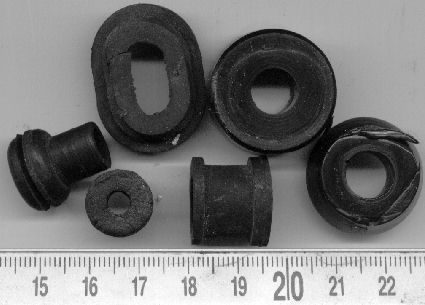

# Chafe Protection

Stop vibration and sharp edges from wearing through insulation.

## When you need this

Any time a wire passes through a hole, runs over an edge, or rubs against something. **Chafing** is when insulation slowly wears away from rubbing. It happens quietly over weeks of practice. Then one day bare copper touches the aluminum frame, and the robot shorts out, trips a breaker, or fails inspection.

The rules say the robot frame must never carry current and every wire must be isolated from it (R611 in 2026). Inspectors check by measuring resistance between the battery terminals and the frame. A wire chafed down to the copper and touching the frame will fail that check.

## Where chafing happens

- **Holes in plates and tubes.** A cut aluminum edge is sharp, even after deburring. Vibration saws the wire back and forth against it.
- **Edges of frame rails, gussets and brackets** that a wire runs over.
- **Moving joints.** Wires that rub against the arm or elevator as it moves.
- **Near chain, belts and gears.** Even a light touch from a moving chain chews through insulation fast.
- **Under zip ties pulled too tight** against a sharp corner.
- **Between the battery and its mount**, where the leads get shoved around every battery swap.
- **Bumpers and belly pans**, where wires get pinched when parts are bolted back on.

## Protection options

### Grommets

A **grommet** is a rubber or plastic ring that lines a hole so the wire touches soft rubber instead of a metal edge.

1. Size the hole in CAD to match the grommet's mounting diameter and the plate thickness. Grommet packages list both.
2. Deburr the hole after cutting.
3. Press the grommet in so its groove grips the plate on both sides.
4. Pass the wire through and tie it down on at least one side so it doesn't slide back and forth.

If a grommet keeps popping out, the hole is too big or the plate is too thick for it.

### Split loom and braided sleeve

**Split loom** is ribbed plastic tubing with a slit down one side. You can push wires into it after they're already connected. It's cheap, tough and good for runs along the frame.

**Braided sleeve** is a woven mesh tube. It's flexible and looks clean, and it's good on wires that move. Cut ends fray, so seal them with a lighter or heat shrink. You usually have to slide braided sleeve on before the connectors go on.

Both add bulk, so leave room for them in CAD.

### Spiral wrap

**Spiral wrap** is a plastic strip wound like a spring around a bundle of wires. You can wrap it on or take it off without unplugging anything, and wires can branch out between the coils. It works well on wires that flex across a joint, as long as there's a little slack.

!!! tip "Photo needed"
    Close-ups from our shop or robot of split loom, spiral wrap installed on real wiring, plus a wire passing through a grommet in a plate.

## Inspecting for wear

Check for chafing before every event, after any big hit, and whenever someone sees a wire touching something it shouldn't.

1. **Unplug the battery.**
2. Look at every place a wire passes through a hole or over an edge. Look for shiny spots, flattened insulation or exposed copper.
3. Move each mechanism through its full range by hand and watch the wires.
4. Run your fingers along wire runs where you can't see well. Flat spots and nicks are easy to feel.
5. Check the frame isolation with a multimeter: one probe on the frame, the other on each battery terminal at the robot's SB50 connector. You should **not** get continuity. See [Electronics Basics](electronics-basics.md#checking-continuity).
6. Fix anything you find. Replace the wire if copper shows. Electrical tape is a temporary patch for a match, not a repair.

## Common mistakes

- Passing a wire through a bare hole because "it's only temporary."
- Deburring the outside of a hole but not the inside of a tube.
- Wires rubbing on a chain or sprocket that only touch at one end of the mechanism's travel.
- Grommets in holes that are the wrong size, so they fall out.
- Wrapping a damaged wire in tape and leaving it for the season.

## Learn more

- [2026 FRC Game Manual](https://firstfrc.blob.core.windows.net/frc2026/Manual/2026GameManual.pdf), rule R611 (frame isolation)
- [WPILib: Wiring Best Practices](https://docs.wpilib.org/en/stable/docs/hardware/hardware-basics/wiring-best-practices.html)
- [Waytek: Wire Harness Protection 101](https://www.waytekwire.com/aboutus/the-waytek-blog/wire-and-cable/wire-harness-protection-101) (general guide to loom, sleeve and grommets)
