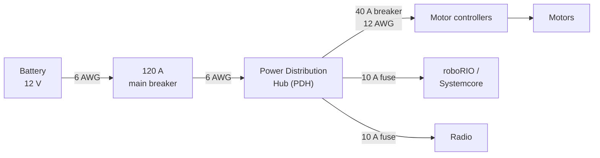
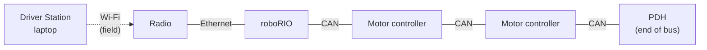

# FRC Control System

What every box on the robot does and how power and signals flow between them.

## When you need this

Read this before you wire, debug or even mount electronics. When the robot won't enable or a motor won't spin, the fix starts with knowing which box feeds which.

!!! warning "The robot controller is changing for 2027"

    Our robots from 2026 and earlier (the ones in the shop right now) all use a roboRIO, and most of this page applies to both. The exact 2027 rules come out with the game manual at Kickoff in January 2027. Until then, treat anything about Systemcore here as "announced, not final." See [Systemcore (2027 and later)](#systemcore-2027-and-later) below.

## The big picture

Two things travel around the robot: **power** (from the battery to everything that uses it) and **signals** (commands and sensor data between the controller and devices).

### Power path

1. The **battery** plugs into the robot through a red SB50 connector.
2. A 6 AWG red wire goes from the battery connector to the **120 A main breaker**. This is the robot's on/off switch.
3. Another 6 AWG wire goes from the main breaker to the **Power Distribution Hub (PDH)**. The black wire from the battery connector goes straight to the PDH's negative input.
4. The PDH splits power into separate **branch circuits**, each with its own breaker or fuse. One device per circuit.
5. Each motor controller, the robot controller and the radio get power from their own PDH channel.

The rules say the battery, connector, main breaker and PDH have to be connected exactly like this with 6 AWG wire or larger, with nothing else added (R609 in the 2026 manual).

### Signal path (CAN and Ethernet)

- The drivers' laptop talks to the robot's **radio** over the field's wireless network.
- The radio connects to the roboRIO with an **Ethernet** cable.
- The roboRIO talks to motor controllers, the PDH and many sensors over **CAN** (Controller Area Network). CAN is a pair of twisted wires, yellow and green, that runs from device to device like a chain.

If CAN breaks partway down the chain, every device after the break stops getting commands. A single loose CAN wire can drop half your motors mid-match.

## Components

!!! tip "Photo needed"
    A labeled top-down photo of our most recent robot's electronics board, with each part below called out (battery connector, main breaker, PDH, roboRIO, radio, a motor controller, RSL).

### Battery and main breaker

The battery is a 12 V, 18 Ah sealed lead-acid battery. Everyone at an event uses the same kind, with the same red or pink **SB50** connector, so you can borrow chargers and batteries.

The **main breaker** is a 120 A circuit breaker. Press its red button to cut power (robot off). Push its lever back in to reset it (robot on). It protects everything downstream from a dead short at the battery.

Rules that matter for where you put them (2026 manual):

- The battery has to be held in so it can't come loose even if the robot flips over (R606).
- Every battery and main breaker terminal must be fully insulated at all times (R607). Use heat shrink on the lugs and cover the breaker studs.
- The main breaker must be quick and safe to reach from outside the robot (R612). Not behind a panel, and not next to a moving part. Field staff need to be able to hit it in an emergency.

Never carry a battery by its wires. It loosens the internal connections and kills the battery early.

### Power Distribution Hub

The **REV Power Distribution Hub (PDH)** takes power from the main breaker and feeds every branch circuit. It also measures the current on each channel and reports it over CAN, which is great for finding a motor that's working too hard.

| Channels | How many | Max | Used for |
|---|---|---|---|
| High-current (0 to 19) | 20 | 40 A breaker (ATO size) | Motor controllers |
| Low-current (20 to 22) | 3 | 15 A fuse (ATM size) | roboRIO, radio, CANcoders |
| Switchable (23) | 1 | 15 A | LEDs or anything you want to turn on and off from code |

Wires go into spring-lever WAGO terminals, no screws. Strip lengths:

| Terminal | Bare strip length |
|---|---|
| Main power input | about 3/4 in (20 mm) |
| High-current channels | about 1/2 in (12 mm) |
| Low-current channels and CAN | about 0.35 in (8 mm) |

After you close each lever, give the wire a firm tug and look for loose strands sticking out. See [Crimping](crimping.md) for using ferrules in these terminals. You can see a labeled photo of the PDH on [REV's PDH overview page](https://docs.revrobotics.com/ion-control/pdh/overview).

Some older robots use the CTRE **Power Distribution Panel (PDP)** instead. It does the same job with a different channel layout.

### roboRIO

The **roboRIO** is the robot computer. It runs our code, talks to the radio and sends commands to everything on the CAN bus. It also drives the **Robot Signal Light (RSL)**, the orange light that blinks when the robot is enabled.

- Power comes from its own PDH low-current channel with a 10 A fuse, and nothing else can share that fuse (R615).
- It has one built-in CAN bus, plus PWM, digital and analog ports for sensors and simple devices.
- When battery voltage drops too low, it shuts off motor outputs to protect itself. This is a **brownout**. See [Electronics Basics](electronics-basics.md#power-and-why-wires-get-hot).

### Systemcore (2027 and later)

**Systemcore** replaces the roboRIO for the 2027 season.

- It has **five CAN ports** (CAN FD, a faster version of CAN) instead of the roboRIO's one, so you can split motors across several buses.
- It has six **Smart I/O** ports that can each be set up as analog input, digital input, digital output or PWM output.
- It also has USB ports, one Ethernet port, I2C ports, an RSL port and a built-in IMU (a sensor that measures rotation).
- It ships with its own power input cables.
- It can't drive relays or power servos directly. The 2027 rule preview removes relays from the allowed list, and servos need a separate power device such as the REV Servo Hub.

### Radio

The **radio** (a Vivid Hosting VH-109) is the robot's wireless link to the field. At events it gets programmed at a kiosk for your team number.

- It gets power from the PDH through a 10 A fuse, either through a PoE (Power over Ethernet) cable into its "RIO" port, a direct 12 V wire, or both (R616, R617). Using both means one bad cable won't knock you off the field.
- Mount it so field staff can see its lights (R708), and keep it away from motors if you can.
- Its Ethernet cable is a common failure point. Make sure it clicks in and is tied down near the plug.

### Motor controllers

A **motor controller** takes battery power from the PDH and feeds the motor exactly as much as the code asks for. One controller drives one motor.

| Controller | Made by | Notes |
|---|---|---|
| SPARK MAX | REV | Separate box. Drives NEO and NEO 550 brushless motors, or brushed motors. |
| SPARK Flex | REV | Separate box that mounts onto a NEO Vortex. |
| Talon FX | CTRE | Built into Kraken X60, Kraken X44 and Falcon 500 motors. No separate box. |

All of them connect to the PDH with a red (V+) and black (V-) power lead on a 40 A breaker, and to the CAN bus. Reversing V+ and V- can destroy a SPARK MAX, so check polarity before plugging in a battery.

### Sensors

Common sensors and how they connect:

| Sensor | What it measures | Connects by |
|---|---|---|
| CANcoder (CTRE) | Absolute angle, often of a swerve module | CAN, plus power from the PDH |
| Pigeon 2 (CTRE) | Robot heading (which way it's facing) | CAN, plus power from the PDH |
| Through Bore Encoder (REV) | Rotation of a shaft | To a motor controller or the roboRIO's DIO ports |
| Limit switch or beam break | Whether something is there | roboRIO DIO port, or a motor controller's limit input |
| Limelight or other camera | Vision targets and AprilTags | Ethernet, plus its own power |

## CAN bus

### Wiring order and termination

CAN is wired as one long chain, called a **daisy chain**. It starts at the roboRIO, goes into and out of each device in turn, and ends at the last device.

- **Yellow** is CAN High. **Green** is CAN Low. Always yellow to yellow, green to green.
- We connect CAN with Molex SL connectors. See [Crimping CAN Connectors](can-crimping.md) for the pinout and how to make them.
- Each end of the chain needs a **120 Ω terminating resistor**. Without it, signals bounce back down the wire and devices drop out.
- The roboRIO has one built in, so it's always one end.
- The PDH has a **TERM** switch. Put the PDH at the far end of the chain and turn TERM on. If the PDH isn't at the end, turn its TERM off and put a 120 Ω terminator on the last device instead. We use a SWYFT CANender (Molex SL version) for this. It's a 120 Ω resistor in a Molex SL connector that plugs into the open end of the last device.
- Don't branch the bus into a "Y." Every device should sit on the main chain.

To check termination, unplug the battery and measure resistance between the yellow and green wires anywhere on the bus. Two 120 Ω resistors in parallel read about **60 Ω**. About 120 Ω means one end is missing. Much lower means an extra terminator or a short.

A **CANivore** (from CTRE) adds an additional CAN bus through a USB port. Teams often put the drivetrain on it so the swerve motors and sensors have a bus to themselves. It needs its own termination at both ends too. With the additional ports on the systemcore, CANivores most likely wont be used.

### CAN IDs

Every device on a bus needs an **ID**, a number from 0 to 62 that the code uses to find it. Devices ship with a default ID (often 0), so a brand-new motor controller will clash with any other new one.

1. Connect one device at a time and set its ID with the vendor tool: **REV Hardware Client** for SPARK MAX, SPARK Flex and PDH, or **Phoenix Tuner X** for CTRE devices.
2. Give every device on the robot a different ID, even across brands. Two different kinds of device can technically share an ID, but unique IDs everywhere avoid mix-ups.
3. Label the device with its ID.
4. Write it on the robot's CAN ID list and tell the programmers.

A common scheme groups IDs by mechanism, like 1 to 8 for the drivetrain, 10s for the intake, 20s for the arm.

!!! question "2928: fill in"
    Our CAN ID scheme, and where the current robot's CAN ID list lives.

## Common mistakes

- Putting the main breaker somewhere you can't reach without lifting a panel.
- Leaving bare battery lugs or main breaker studs uninsulated.
- Forgetting to turn on the PDH TERM switch.
- Swapping yellow and green somewhere in the CAN chain.
- Two devices with the same CAN ID. Usually one of them just doesn't respond.
- Reversing V+ and V- on a motor controller.
- Mounting the radio where its lights are hidden.

## Learn more

- [WPILib: Introduction to FRC Robot Wiring](https://docs.wpilib.org/en/stable/docs/zero-to-robot/step-1/intro-to-frc-robot-wiring.html)
- [WPILib: CAN Wiring Basics](https://docs.wpilib.org/en/stable/docs/hardware/hardware-basics/can-wiring-basics.html)
- [REV: Power Distribution Hub specifications](https://docs.revrobotics.com/ion-control/pdh/specs)
- [FIRST: Systemcore pricing and availability (2026)](https://www.firstinspires.org/community-blog/2026-systemcore-pricing-and-availability) and [March 2025 update on Systemcore hardware](https://www.firstinspires.org/community-blog/march-updates-on-the-future-robot-controller)
- [WPILib: New for 2027](https://docs.wpilib.org/en/latest/docs/yearly-overview/yearly-changelog.html)
