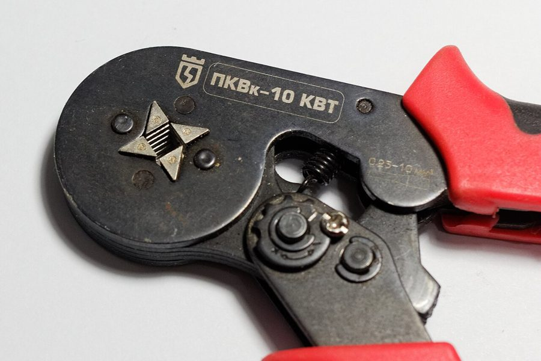
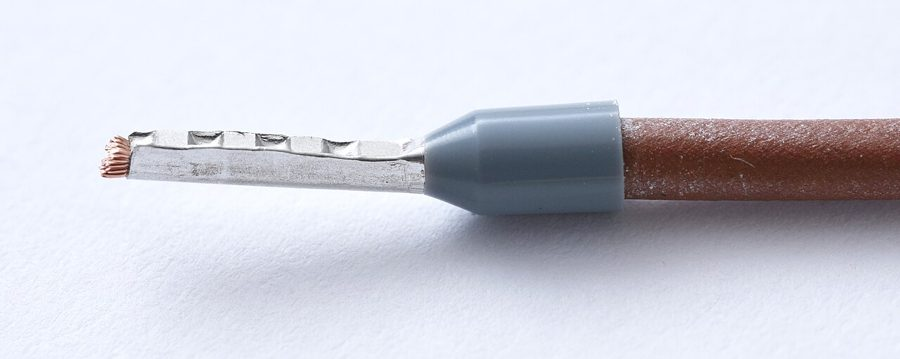
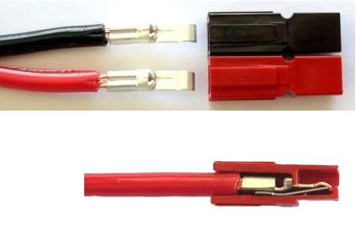
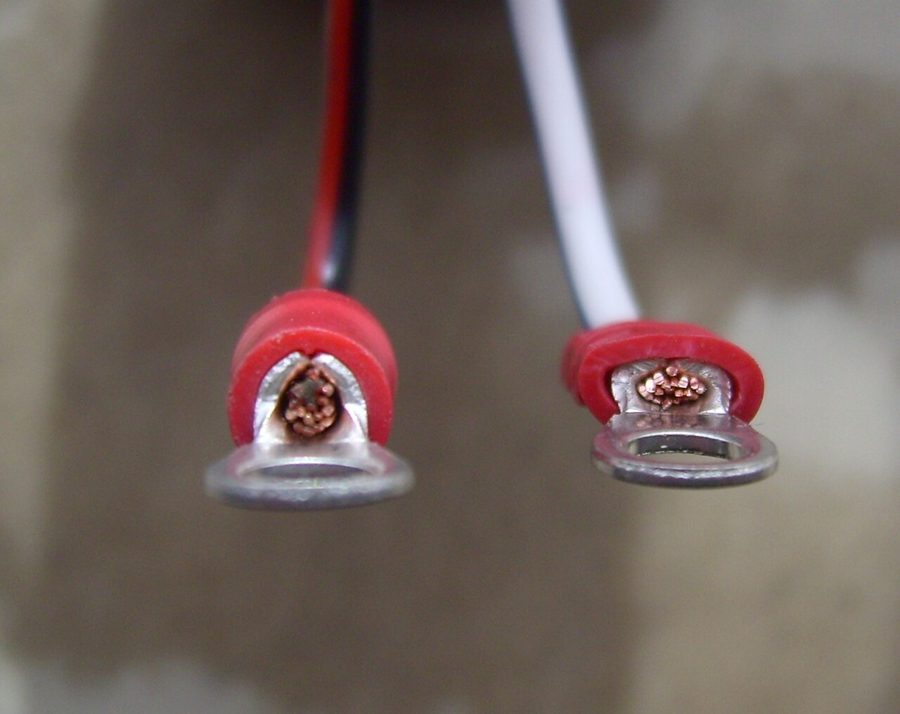

# Crimping

How to make reliable crimped connections for each connector type we use.

## When you need this

Any time you put a connector on the end of a wire. A **crimp** joins a wire to a metal connector by squeezing them together so hard that the copper strands and the connector act like one piece of metal. Done right, it's stronger and more reliable than solder on a robot that gets slammed around. Done wrong, it looks fine on the bench and falls apart in your second match.

## Tools

Every connector type has its own crimper. Pliers are not a crimper. A ratcheting crimper won't open until it has squeezed all the way, which is what makes the crimp consistent.

| Tool | Used for |
|---|---|
| Wire strippers (self-adjusting, or with gauge-marked holes) | Removing insulation without cutting strands |
| Flush cutters | Clean square cuts |
| Ferrule crimper, square or hex jaws | Ferrules for WAGO terminals on the PDH and lever nuts |
| Powerpole crimper | Anderson Powerpole contacts |
| Molex SL crimper (63811-8700) | CAN connectors. See [Crimping CAN Connectors](can-crimping.md). |
| Fine-pin crimper (open barrel) | PWM, Dupont and JST pins |
| Insulated terminal crimper (red/blue/yellow marks) | Ring and spade terminals |
| Hammer crimper or hydraulic crimper | 6 AWG battery and main breaker lugs |
| Heat gun | Heat shrink |

## Stripping wire

Every crimp starts with a good strip.

1. Cut the wire end square with flush cutters.
2. Check the strip length for the connector you're using (each section below says how long).
3. Strip in one smooth motion. Use the hole that matches the wire gauge.
4. Look at the strands. If any are cut or nicked, cut the end off and strip again. Every missing strand is less copper to carry current.
5. Give the strands a light twist in the direction they're already laid so none stick out.

Too short and the crimp only grabs insulation. Too long and bare copper sticks out past the connector, where it can short against something.

## Connector types

### Ferrules (Wago and PDH)

A **ferrule** is a thin metal tube you crimp over stranded wire. It turns a floppy bundle of strands into one solid pin.

Why bother? The PDH and WAGO lever nuts hold wire with a spring clamp. Bare stranded wire can splay, so some strands miss the clamp, or a stray strand touches the next terminal. A ferrule fixes both.

1. Pick a ferrule sized for your wire gauge. The ferrule's size is printed on the package.
2. Strip so the bare copper is the same length as the ferrule's metal tube.
3. Push the wire in until the insulation is snug against the plastic collar and the strands reach the end of the tube. Strands can poke out the tip a tiny bit, as in the photo.
4. Crimp with the square or hex crimper. Use a square or hex crimp for the PDH.
5. Pull test (see below), then insert into the terminal and close the lever.

Check REV's specs for the largest ferrule each PDH terminal accepts. For example, the high-current channels take bare wire up to 8 AWG but ferrules only up to 10 AWG.

### Anderson Powerpole

**Anderson Powerpole** connectors are the red and black plastic blocks many teams use between the PDH and motor controllers. Each side has a plastic **housing** and a metal **contact** you crimp onto the wire. Any two housings of the same series mate with each other, so there's no pin side or socket side. Every half is the same.

For motor circuits, use the 1327-series housing with **45 A contacts**, which fit 10 to 14 AWG wire.

1. Strip the wire so the bare copper is the same length as the contact's crimp barrel. No copper should go past the barrel into the gap before the contact tip.
2. Put the wire in the contact and crimp with the Powerpole crimper.
3. Push the contact into the back of the housing until it clicks. If it won't click, check it's the right way up against the bottom picture above, which shows a fully seated contact.
4. Pull on the wire. If the contact backs out, it wasn't seated. Push it in until it clicks.
5. Slide the red and black housings together sideways along their dovetails.

A contact that isn't fully seated can push back when you plug in, which causes brownouts or makes one phase of a brushless motor cut out.

!!! note "CAN connectors have their own page"
    CAN wiring uses Molex SL connectors, and it's the most important wiring on the robot. Follow [Crimping CAN Connectors (Molex SL)](can-crimping.md) for those.

### Ring and spade terminals

A **ring terminal** has a closed loop that goes over a screw or stud. A **spade** has an open fork. Use rings anywhere a screw might loosen, since a ring can't slide off.

Insulated terminals are color-coded by wire size: red for 22 to 18 AWG, blue for 16 to 14 AWG, yellow for 12 to 10 AWG. Crimp each in the matching color slot of the crimper.

The terminal on the left hasn't been crimped yet. The one on the right has, and its strands fill the barrel with no gaps. If a crimped terminal still shows gaps, the crimp is loose or the terminal is too big for the wire.

### Battery lugs

The battery, the main breaker and the PDH input are wired with **6 AWG** wire (the rules' minimum), and the ends get heavy copper **lugs**.

1. Pick lugs rated for 6 AWG with a hole that fits the stud. Use lugs for #10 or M5 battery tabs.
2. Strip so the copper fills the lug barrel all the way, with no gap between the barrel and the insulation.
3. Crimp with hydraulic crimper. Hand crimpers can't squeeze 6 AWG hard enough.
4. Slide heat shrink over the barrel and shrink it.
5. Bolt the lug flat against the battery tab or breaker stud. No washer between the lug and the tab. Ensure the bolt is tight and the terminals cant move
6. Cover every bit of exposed metal. The rules require every battery and main breaker terminal to be insulated at all times (R607 in 2026).

!!! warning
    A battery can deliver hundreds of amps into a short circuit. Do lug work with the battery disconnected, and never let a wrench touch both terminals. Read [Shop Safety](../general/safety.md) first.

!!! tip "Photo needed"
    A finished 6 AWG battery lead from our shop: lug crimped, heat shrink on, bolted to a battery. Ideally next to a bad one (crimped with pliers or missing heat shrink).

## Testing a crimp

Look before you pull. A good crimp has:

- No bare copper sticking out where it shouldn't.
- No cut or folded-back strands.
- The insulation right up against the connector, not stripped back an extra 1/4 in.
- The crimp mark centered on the barrel, not on the edge.
- A connector that isn't cracked or bent.

### The pull test

1. Hold the connector in one hand and the wire in the other, close to the connector.
2. Pull hard and steady for a few seconds. For big wires, pull about as hard as you'd pull to open a stuck door. For tiny signal pins, pull firmly but don't yank.
3. Nothing should move. Not even a little.
4. If the wire slides, stretches out of the barrel or comes off, cut the connector off and redo it. Don't re-crimp the same connector.

A crimp that fails the pull test in the shop is a crimp that would have failed on the field.

## Common mistakes

- Using pliers instead of the right crimper.
- Using the wrong die size, like crimping a 12 AWG contact in the 16 AWG slot.
- Nicking strands while stripping.
- Stripping too long, leaving bare copper outside the connector.
- Crimping on the insulation instead of the copper.
- A Powerpole contact that never clicked into its housing.
- Skipping the pull test because "it looks fine."
- Re-crimping a bad connector instead of cutting it off and starting over.

## Learn more

- [REV: Anderson Powerpole Connectors](https://docs.revrobotics.com/brushless/tips/anderson-connectors)
- [REV: Wiring the Power Distribution Hub](https://docs.revrobotics.com/ion-control/pdh/gs/wiring) and [PDH specifications](https://docs.revrobotics.com/ion-control/pdh/specs) (strip lengths and ferrule sizes)
- [WPILib: Robot Battery Basics](https://docs.wpilib.org/en/stable/docs/hardware/hardware-basics/robot-battery.html) (battery lugs and heat shrink)
- [WPILib: Wiring Best Practices](https://docs.wpilib.org/en/stable/docs/hardware/hardware-basics/wiring-best-practices.html)
