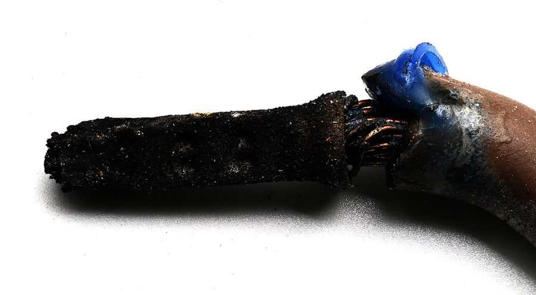
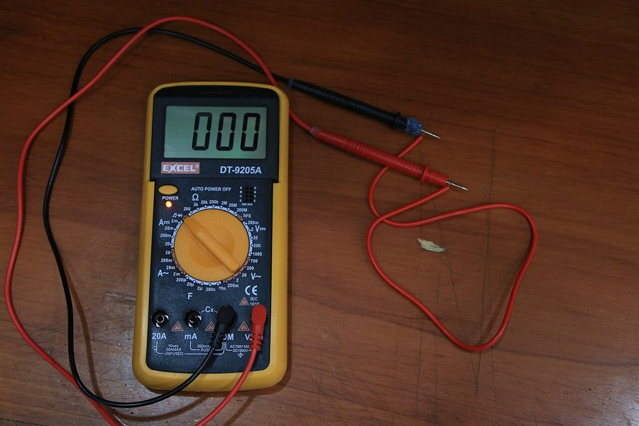

# Electronics Basics

Voltage, current and resistance, and why they matter on a 12 V robot.

## When you need this

Read this before you touch any wiring. Everything else in the Electrical section (wire sizes, crimps, breakers) makes more sense once you know why a wire gets hot and why a loose connection makes a robot stutter.

## Voltage, current and resistance

A battery pushes electrons through a wire, through a device, and back to the battery. Three numbers describe that loop:

| Quantity | Unit | Symbol | What it means |
|---|---|---|---|
| Voltage | volt (V) | V | How hard the battery pushes. Our robot battery is about 12 V. |
| Current | amp (A) | I | How much electricity is flowing. A drive motor pushing hard can pull more than 100 A for a moment. |
| Resistance | ohm (Ω) | R | How much something fights the flow. Thin wire, long wire and bad connections all add resistance. |

A complete loop is called a **circuit**. If the loop is broken anywhere (a wire pulled out of a terminal, a tripped breaker), no current flows and the device stops.

### Ohm's law

**V = I × R**

In this case, **"V"** is voltage *drop*. As voltage drops, the strength of motors diminishes and eventually the robot will shut off.

Example: a bad crimp has 0.01 Ω of resistance. That sounds tiny. But if a motor pulls 80 A through it, the voltage lost across that one crimp is 80 × 0.01 = 0.8 V. The motor now sees 0.8 V less than it should, and that's just one connection. Add a few bad ones and the robot gets sluggish.

### Series and parallel

- **Series** means one after another in a single path. The same current flows through every part, and the resistances add up. Every connector between the battery and a motor is in series with it, which is why each one has to be good.
- **Parallel** means side by side, each on its own branch. Every branch sees the same voltage, and the currents add up. Every motor controller on the robot is wired in parallel off the Power Distribution Hub, so all of their currents add up at the battery.

That second point is why the main battery wire is so thick. Four drive motors pulling 60 A each is 240 A through one wire for a moment.

## Power and why wires get hot

**Power** is how much energy is used each second, measured in watts (W).

**P = V × I**, and for heat in a wire or connection, **P = I² × R**.

Double the current and you get four times the heat. A connection that's fine at 5 A can melt its insulation at 40 A.

This ferrule (a metal sleeve crimped onto a wire end) had too much resistance where it met its terminal. All the heat from I² × R went into that one spot until the plastic melted. On a robot the same thing could happen at loose battery lugs and half-inserted Powerpole contacts. Even if it doesn't burn, it will lead to large amounts of wasted energy, leading to a robot that dies before the match is over.

Too much resistance on a robot also causes **brownouts**. When the battery voltage sags low enough, the robot controller shuts off motor outputs to protect itself. On a roboRIO this happens around 6.3 V (roboRIO 1.0) or 6.75 V by default (roboRIO 2.0). This normally looks like a stuttering robot when the drivers accelerate, or mechanisms that begin to sag towards the end of the match.

## Wire gauge (AWG)

Wire size is given in **AWG** (American Wire Gauge). The number goes the opposite way you would expect: a smaller number is a thicker wire. 6 AWG is about as thick as a pencil. 22 AWG is thinner than a phone charger cable.

Thicker wire has less resistance, so it can carry more current without getting hot. That's why the rules tie the wire size to the breaker or fuse protecting it. The breaker trips before the wire can overheat, but only if the wire is big enough for that breaker.

### Which gauge for which circuit

These minimums come from the 2026 FRC Game Manual (rules R609 and R622, Table 8-4). The 2027 manual comes out at Kickoff in January 2027, so check it then.

| Circuit | Protected by | Minimum wire |
|---|---|---|
| Battery to main breaker to PDH | 120 A main breaker | 6 AWG |
| Motor controller (Kraken, NEO, Falcon, etc.) | 31 to 40 A breaker | 12 AWG |
| Smaller motor or mechanism | 21 to 30 A breaker | 14 AWG |
| Servo power module, other mid-size loads | 6 to 20 A breaker, or 11 to 20 A fuse | 18 AWG |
| Small loads on a 10 A fuse or 5 A breaker | 10 A fuse | 22 AWG |
| Signal wires (CAN, sensor outputs) | Can't supply more than 1 A | 28 AWG |

A few more rules from the same section:

- Wire has to be copper. Copper-clad aluminum counts as copper. Signal wires are exempt.
- Wires that came attached to a legal device (like the leads on a SPARK MAX) are legal as they are.
- Only one wire goes into each terminal on the PDH (R618). If you need to split power, splice it into one lead first.
- Positive wires must be red, yellow, white, brown or black-with-stripe. Negative wires must be black or blue (R624). We use red and black.

Bigger is always allowed. Lots of teams run 10 AWG to drive motors because the voltage drop is lower than 12 AWG.

## Using a multimeter

A **multimeter** measures voltage, resistance and continuity. It's the first tool you grab when something electrical is wrong.

The black probe always goes in the **COM** jack. The red probe goes in the **VΩ** jack for almost everything we do. The **A** or **20A** jack is only for measuring current directly, and plugging into it by accident and then touching the battery can blow the meter's fuse. Leave it alone unless a mentor shows you.

### Checking voltage

Use this to check a battery or see if power is reaching a device.

1. Turn the dial to **V** with a straight line (DC volts). On a meter without auto-ranging, pick the 20 V range.
2. Touch the red probe to the positive side and the black probe to the negative side.
3. Read the number. A negative number means the probes are backwards. Nothing breaks, just swap them.

A fully charged robot battery with nothing connected reads about 12.7 to 13.5 V. If it reads lower, charge it before it goes on the robot. A resting voltage only tells you part of the story, though. A worn-out battery can show 12.8 V and still sag badly under load. A battery analyzer (such as a Battery Beak) or a load test checks that.

### Checking continuity

Continuity means "is there an unbroken path between these two points?" Use it to find broken wires and bad crimps.

1. **Unplug the battery first.** Never check continuity or resistance on a powered circuit.
2. Turn the dial to the continuity setting (the symbol looks like a sound wave or a diode arrow). Touch the probes together. The meter should beep and read close to 0.
3. Touch one probe to each end of the wire or connection you're checking.
4. A beep means the path is good. No beep means it's broken somewhere.

You can also wiggle the wire while you test. A beep that cuts in and out points to a cracked wire or a loose crimp.

The same setting finds short circuits. With the battery unplugged, touch one probe to the robot frame and the other to each battery post on the PDH side of the connector. The meter should **not** beep. The frame must never be part of a circuit (R611), and inspectors check this.

## Common mistakes

- Trusting a resting voltage reading to say a battery is good.
- Blaming code for a robot that stutters under load. Check connections and battery as well as current limits in the code.

## Learn more

- [2026 FRC Game Manual](https://firstfrc.blob.core.windows.net/frc2026/Manual/2026GameManual.pdf), section 8.6 Power Distribution (rules R609 to R624 and Table 8-4)
- [WPILib: roboRIO Brownout and Understanding Current Draw](https://docs.wpilib.org/en/stable/docs/software/roborio-info/roborio-brownouts.html)
- [WPILib: Robot Battery Basics](https://docs.wpilib.org/en/stable/docs/hardware/hardware-basics/robot-battery.html)
