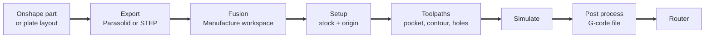

# CAM in Fusion 360

!!! note "Coming soon"
    This page is still being written.

<!--
NOTE: Mermaid arrows below were changed from "two dashes and >" to ==> so they do not end this comment early. Change them back when restoring.

Turning an Onshape part into a toolpath for the router.

## When you need this

Before any part can be cut on the [CNC router](laguna-cnc.md). **CAM** (computer-aided manufacturing) is the step between the CAD model and the machine. You tell the software what stock you have, which cutter to use and which edges to cut. It calculates the **toolpath** (the exact route the cutter follows) and writes it out as **G-code**, the text file of move commands the router reads.

We design in Onshape but do CAM in Autodesk Fusion (still often called Fusion 360), which has free CAM for students and educators.

## Before you export: design for the router

A few things in the CAD make CAM easier. Fix them in Onshape, not in Fusion.

- **Inside corners need a radius.** A round cutter can't cut a sharp inside corner. The smallest inside radius is the cutter's radius (1/16" for a 1/8" cutter). Where a square part has to fit into a pocket, add **dogbones**. The Dogbone FeatureScript in [Getting Started](../cad/getting-started.md#step-3-add-the-recommended-featurescripts) does this.
- **Plates must be flat.** Router parts are 2D: one thickness, cut straight down. Pockets are fine if they're flat-bottomed.
- **Lay out the sheet.** The Auto Layout FeatureScript arranges plates of the same thickness onto a sheet, so you run one job instead of many.
- **Check the material thickness.** Measure the real sheet. If it's 0.236" instead of 0.250", the CAM needs to know.

## Exporting from Onshape

1. In the Part Studio, select the part (or the layout of parts) in the Parts list.
2. Right-click and choose **Export**. To export everything in the Part Studio, right-click the Part Studio tab instead.
3. Set **Format** to **Parasolid** (preferred) or **STEP**. If you pick STEP, check **Use custom units for export** and choose Inch, since STEP files default to meters.
4. Choose **Download** and click **Export**.

Parasolid keeps the geometry exact and avoids the units problem. Both open fine in Fusion.

In Fusion, open the file with **File > Open > Open from my computer**, or upload it in the Data Panel. Then switch the workspace dropdown (top left) from **Design** to **Manufacture**.

## Setup in Fusion

A **setup** tells Fusion where the stock is and where the origin is. Click **Setup > New Setup**.

### Stock and origin

On the **Setup** tab:

1. **Operation type: Milling.**
2. **Work Coordinate System (WCS).** This is the origin, the point the router calls X0 Y0 Z0. Set the orientation so Z points straight up out of the sheet. Set the **origin** to a corner of the stock (usually the front-left corner, top surface). Pick the **Stock box point** option and click the corner.

On the **Stock** tab:

1. **Mode: Fixed size box** for a sheet. Type the real size of the sheet and the measured thickness.
2. Position the part in the stock so there's a margin around it for screws or clamps.

Whatever point you pick as the origin here is the point you'll touch off on the router. If they don't match, the part gets cut in the wrong place.

!!! question "2928: fill in"
    What is our standard origin (which corner, top of stock or spoilboard surface)? What sheet sizes do we normally load? Do we keep a Fusion template with our setup and toolpaths already in it?

### Tool library

Fusion needs to know the exact cutter. Open **Manage > Tool Library**.

- Each tool has its **geometry** (diameter, number of flutes, flute length, overall length) and its **cutting data** (spindle speed, feed rate, plunge rate).
- Use the team's library, not the sample libraries. The sample tools have speeds and feeds for big industrial mills, not our router.
- Single-flute **O-flute** carbide cutters are common for routing aluminum and plastic, because the one big flute clears chips well at router speeds.

Feed rate comes from **chip load**, the thickness of material each flute removes per turn:

**Feed rate (in/min) = RPM x number of flutes x chip load**

For a 1/8" single-flute cutter in sheet aluminum, published starting points are around 0.002" to 0.004" chip load ([BuildYourCNC, for Onsrud single-flute bits](https://buildyourcnc.com/products/endmill-singleflute-upcut-125-1-flute)). At 18,000 RPM and 0.002", that's 18,000 x 1 x 0.002 = 36 in/min. Too low a chip load makes dust and heat and melts plastic or welds aluminum onto the cutter. Too high breaks the cutter.

!!! question "2928: fill in"
    Our proven tool library: which cutters we stock (diameter, flutes, brand), and the RPM, feed, plunge and depth-per-pass we use for 1/8" and 1/4" aluminum and polycarbonate. Where is the library file kept?

## Toolpaths

Contour, pocket and bore are in the **2D** menu. A typical plate job runs in this order: holes, then pockets, then the outside contour last, so the part stays attached to the sheet as long as possible.

For each operation, check the **Heights** tab. The **Bottom height** controls how deep the cut goes. For through cuts, set it a little below the bottom of the stock so the cutter goes all the way through into the spoilboard.

### 2D contour

Cuts along an edge. Use it for the outside profile and for holes bigger than the cutter.

1. **Tool** tab: pick the cutter.
2. **Geometry** tab: click the bottom edge of the part's outline. Check the red arrow shows the cutter on the **outside** of the part (or inside, for a hole). If it's on the wrong side, the part comes out a cutter-width too small.
3. **Heights** tab: Bottom height a little below the stock bottom.
4. **Passes** tab: turn on **Multiple depths** and set **Maximum roughing stepdown** so it cuts in several shallow passes.
5. **Linking** tab: use a ramp entry so the cutter spirals or slopes down into the material instead of plunging straight down.

### 2D pocket

Clears out an area inside the part to a set depth, like a lightening pocket that doesn't go all the way through, or a recess for a bearing. Select the bottom face or edge of the pocket. Use a ramp or helical entry so the cutter doesn't plunge straight down.

For through-pockets in thin plate, many teams use a 2D contour around the pocket edge instead, so the middle drops out as one slug. Add tabs to hold the slug (see below).

### Drilling

The **Drilling** menu has a **Drill** operation, but routers aren't great drills. Common choices on a router:

- **Holes larger than the cutter**: cut them with a 2D contour or the **Bore** operation (which spirals down around the hole).
- **Holes the same size as a drill bit**: use Drill with a spot drill to mark the location, then drill them to size on the [drill press](drill-press.md). This works well for tapped holes.

### Tabs

**Tabs** are small bridges of material the contour leaves uncut, so the part stays attached to the sheet until the end. Without them, a part that's cut free can shift, catch on the cutter and get thrown or ruined.

In the 2D contour, on the **Geometry** tab, turn on **Tabs**. You can set:

- **Tab shape**: rectangular or triangular.
- **Width** and **height**.
- **Tab positioning**: by distance (one every X inches) or by number of tabs per contour. You can also click on the contour to place them by hand.

Put tabs on straight edges, not in corners or on curves, so they're easy to file off. After the job, cut the tabs with a deburring blade, flush-cut snips or a file. See [Deburring](deburring.md).

## Simulating and posting

1. Select the setup and click **Actions > Simulate**. Watch the stock being cut. Check for:
    - Red marks or collisions, where the tool holder or cutter hits something it shouldn't.
    - Cuts in the wrong spot or wrong depth.
    - Missing holes or pockets.
    - The tool going below the spoilboard much more than you intended.
2. Fix any problem in the operation and simulate again.
3. Select the setup and click **Actions > Post Process**. Choose our router's post processor. A **post processor** converts Fusion's toolpaths into G-code in the exact dialect the router understands. Using the wrong post can make the machine move in ways you don't expect.
4. Give the program a clear name (part name, material, thickness) and click **Post**. Save the file to a USB drive.

!!! question "2928: fill in"
    Which post processor do we use for our Laguna, and where is it saved? What file extension does the router expect (.nc, .tap, other)?

## Common mistakes

- Contour on the wrong side of the line, so the part is one cutter-width undersize.
- Origin in Fusion doesn't match the origin you set on the router.
- STEP exported in meters, or stock thickness left at the CAD thickness instead of the measured one.
- Bottom height left at the top of the stock, so nothing cuts through.
- Forgetting tabs, so the part breaks free on the last pass.
- Sharp inside corners in the CAD that the cutter can't make.
- Using sample library speeds and feeds meant for a different machine.
- Skipping the simulation.

## Learn more

- [Autodesk: 2D contour tabs reference](https://help.autodesk.com/cloudhelp/ENU/Fusion-CAM/files/MFG-REF-2D-CONTOUR-TABS.htm)
- [Autodesk: 2D contour reference](https://help.autodesk.com/cloudhelp/ENU/Fusion-CAM/files/GUID75B6821B-DE26-4E3B-AF10-4A54131CD9E4.htm)
- [Onshape: exporting files](https://cad.onshape.com/help/Content/exporting-files.htm)
- [Purdue BIDC: mill toolpath guide](https://www.purdue.edu/bidc/resources/metal-working/mill-toolpath-guide/), a plain-language guide to Fusion toolpath choices
-->
