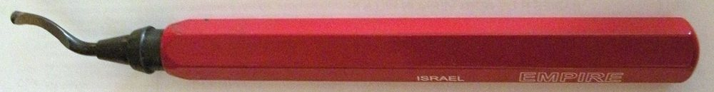

# Deburring

Removing sharp edges so parts fit and nobody gets cut.

## When you need this

After every cut, on every part. Drilling, sawing, routing and turning all leave a **burr**: a thin, sharp lip of metal pushed up along the edge of a cut. Burrs cut hands and wires, stop parts from sitting flat against each other, and keep bearings and shafts from sliding in. A plate with burrs on its holes won't bolt flat to a tube, and a hex shaft with a burr on the end won't go through the bearing.

A part isn't finished until it's deburred. Run a finger lightly along the edge once you think you're done (carefully, along the edge, not across it). It should feel smooth, not scratchy.

## Tools

### Deburring blade

A hooked blade on a handle that swivels. This is the tool you'll use most. Drag it along an edge and it peels off a thin curl of metal. It works on straight edges, curves and the edges of holes, and it's great on aluminum and plastic.

- Pull it toward you or along the edge at a shallow angle. Light pressure is enough.
- Keep the hand holding the part out of the blade's path. The blade slips off the end of the edge.
- Blades get dull and chip. Replace them when the tool starts chattering instead of cutting smoothly.

### Countersink

A cone-shaped cutter. A few turns in a drilled hole cleans up the burr and leaves a small, even chamfer. Use a hand countersink with a handle, or chuck one in the drill press and just touch the hole. Don't go deep. The goal is to remove the burr, not to make a countersunk hole for a flat-head screw.

### Files

A file is a hardened steel bar covered in rows of small teeth. Use it on the sawn ends of tube and bar and on outside edges.

- Files cut on the **push** stroke only. Lift slightly or ease off on the way back.
- Clean the teeth with a **file card** (a wire brush for files) when they clog with aluminum.
- Keep aluminum files and steel files separate if you can. Steel bits stuck in a file scratch aluminum parts.

### Scotch-Brite

Abrasive nylon pads (and wheels). Rubbing a part with a Scotch-Brite pad takes off the tiny leftover burrs and gives a clean, even brushed finish. It's the last step, not a replacement for a blade or file.

## Steps

1. Wait for the part to cool if it just came off a machine.
2. Clamp it in a vise if it's small or awkward, or hold it flat on the bench.
3. Blade or file every cut edge. On tube, do the outside edges of the cut end, then the inside edges.
4. Countersink both sides of every drilled hole. On tube, reach inside with the deburring blade to get the inside edge of holes too, since that burr can stop a shaft or bearing from going through.
5. For router-cut plates, run the deburring blade around the outside and every pocket. Cut off and file down any leftover tabs (see [CAM in Fusion](cam-fusion.md)).
6. Check by feel and by eye. Test-fit bearings, shafts and bolts.
7. Sweep up the chips. Aluminum slivers in the carpet or on a workbench end up in someone's hand.

## Common mistakes

- Skipping the inside of tube holes.
- Pressing so hard with the countersink that it leaves a big chamfer.
- Leaving a part "for someone else to deburr." Do it when you make it.

## Learn more

- [University of Rochester: basic shop safety and tools](https://www.rochester.edu/ase/studentessentials/fabrication/articles/basic-shop-safety-and-tools.html)
- [University of Florida: speeds and feeds](https://web.mae.ufl.edu/designlab/Advanced%20Manufacturing/Speeds%20and%20Feeds/Speeds%20and%20Feeds.htm), for countersink speeds
- [FIRST: FRC tool recommendations](https://community.firstinspires.org/hubfs/web/program/frc/resources/frc-tool-recommendations.pdf)
