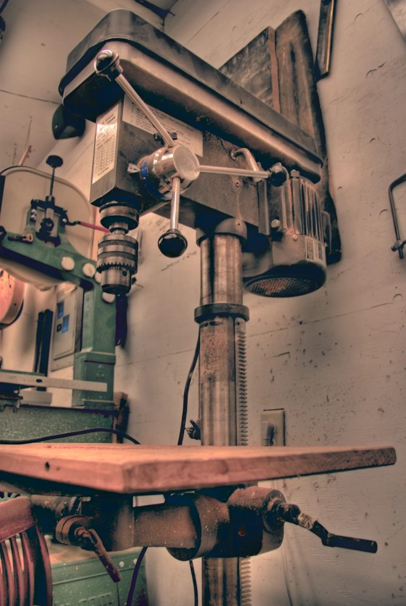

# Drill Press

Drilling accurate, square holes.

!!! warning "Sign-off required"
    You must be signed off by a mentor on the drill press before you use it. Read [Shop Safety](../general/safety.md) first.

## When you need this

Any hole that a hand drill can't put in the right place or straight enough: bearing holes, bolt holes in tube, holes you'll tap later. The drill press holds the bit perfectly vertical and lets you feed it down with a lever, so the hole comes out square to the part.

The parts you'll use:

- **Chuck**: the three-jaw clamp that holds the drill bit. Tightened with a **chuck key**.
- **Quill**: the part that moves down when you pull the **feed handles**.
- **Table**: where the vise or part sits. It moves up and down the **column** and locks in place.
- **Depth stop**: a nut on a threaded rod that stops the quill at a set depth.
- **Speed control**: a belt and pulleys under the top cover, or a lever or dial on newer machines.

## Safety

- Safety glasses, always. No gloves. Hair tied back, sleeves rolled up.
- **Never leave the chuck key in the chuck.** If the machine starts with the key in, it gets thrown across the room. Take the key out and put it down every single time, even if you're about to use it again.
- **Clamp every part.** If a drill grabs a hand-held part, the part spins with the bit and cuts whoever is holding it. This is the most common drill press injury.
- Clear chips with a brush, with the spindle stopped. Long stringy chips can wrap around the bit. Stop the machine to clear them.
- Never reach under or around the spinning bit.

## Setup

### Choosing a drill bit

- **Size.** Check the drawing. Holes for screws to pass through are clearance holes. Holes you'll tap use a tap drill size from the [tap drill chart](tapping.md#tap-drill-sizes). Drill bits come in fractions (1/4"), numbers (#7), letters (F) and millimeters. The size is printed on the bit shank and in the drill index.
- **Condition.** The bit should be sharp, straight and not chipped. A dull bit squeals, makes dust instead of chips and drills oversize.
- **Type.** Regular jobber drills are fine for most work. Use a **center drill** or **spot drill** first if the hole has to be very accurately located. Use a **step drill** for holes in thin sheet and tube walls, since a big twist drill grabs and tears thin material.

### Speed setting

Use the formula on [Machining Basics](machining-basics.md#speeds-and-feeds-in-plain-words): RPM = (cutting speed x 3.82) / drill diameter. With HSS drills that gives these starting points:

| Drill size | Aluminum (250 SFM) | Mild steel (100 SFM) |
|---|---|---|
| 1/8" | about 7,600 RPM | about 3,000 RPM |
| 1/4" | about 3,800 RPM | about 1,500 RPM |
| 1/2" | about 1,900 RPM | about 760 RPM |

Most drill presses top out well below 7,600 RPM, so small drills in aluminum just run at the fastest setting. Pick the closest setting at or below the number. If you see smoke, blue chips or a burning smell, go slower. In reality, we rarely ever change the speed of the drill press and it cuts through aluminum just fine.

Change speeds with the machine off and unplugged or locked out, especially if it means opening the belt cover.

### Clamping the part

1. Put a scrap block under the part where the drill will come through, so you don't drill the vise or table.
2. Small parts and tube go in the **drill press vise**. Tighten it firmly. Rest the part on parallels (precision steel bars) if it needs to sit level and the drill must clear the vise bottom.
3. Big plates get clamped straight to the table with C-clamps or quick clamps, at least two of them.
4. Line the center punch mark up under the drill tip. Lower the quill with the machine off until the tip just touches the punch mark, then tighten the vise or clamps.
5. Clamp the vise to the table too if using it.

## Steps

1. Lay out and center punch the hole (see [Machining Basics](machining-basics.md#center-punch)).
2. Put the bit in the chuck. Push it in until it's held mostly by the smooth shank, not the flutes. Tighten using the key in at least two of the three key holes. **Remove the key.**
3. Clamp the part as above. Set the depth stop if the hole doesn't go all the way through.
4. Put on safety glasses. Check sleeves, hair and gloves.
5. Turn the machine on. Let it come up to speed.
6. Feed the bit down with steady pressure. You should see a chip curling off each side. Add a drop of cutting fluid for aluminum or oil for steel.
7. For holes deeper than about three times the drill diameter, **peck**: drill a bit, pull up to clear the chips, drill a bit more.
8. Ease off as the bit breaks through. That's when it is most likely to grab, especially in thin sheet and polycarbonate.
9. Raise the bit out of the hole and turn the machine off. Wait until it stops.
10. Brush the chips away. Unclamp the part and [deburr](deburring.md) both sides of the hole.

For holes bigger than about 3/8", drill a smaller **pilot hole** first (a little wider than the chisel point at the tip of the big drill), then drill the final size. It's easier on the machine and the hole stays on location.

## Common mistakes

- Leaving the chuck key in the chuck.
- Holding the part by hand.
- No scrap block underneath, so the drill goes into the vise.
- Pushing too hard as the drill breaks through, so it grabs and spins the part.
- Drilling a tap hole with the clearance drill (or the other way around). Double-check the bit size before you start.

## Learn more

- [University of Toronto: The Drill Press](https://www.mie.utoronto.ca/wp-content/uploads/2016/10/MODULE-1-The-Drill-Press.pdf), a short student training module
- [University of Florida: speeds and feeds](https://web.mae.ufl.edu/designlab/Advanced%20Manufacturing/Speeds%20and%20Feeds/Speeds%20and%20Feeds.htm), including peck depths
- [FIRST: FRC tool recommendations](https://community.firstinspires.org/hubfs/web/program/frc/resources/frc-tool-recommendations.pdf)
