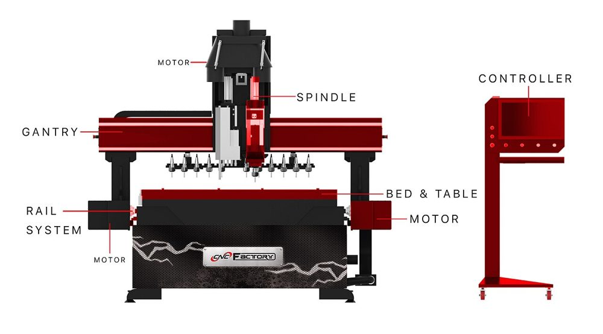
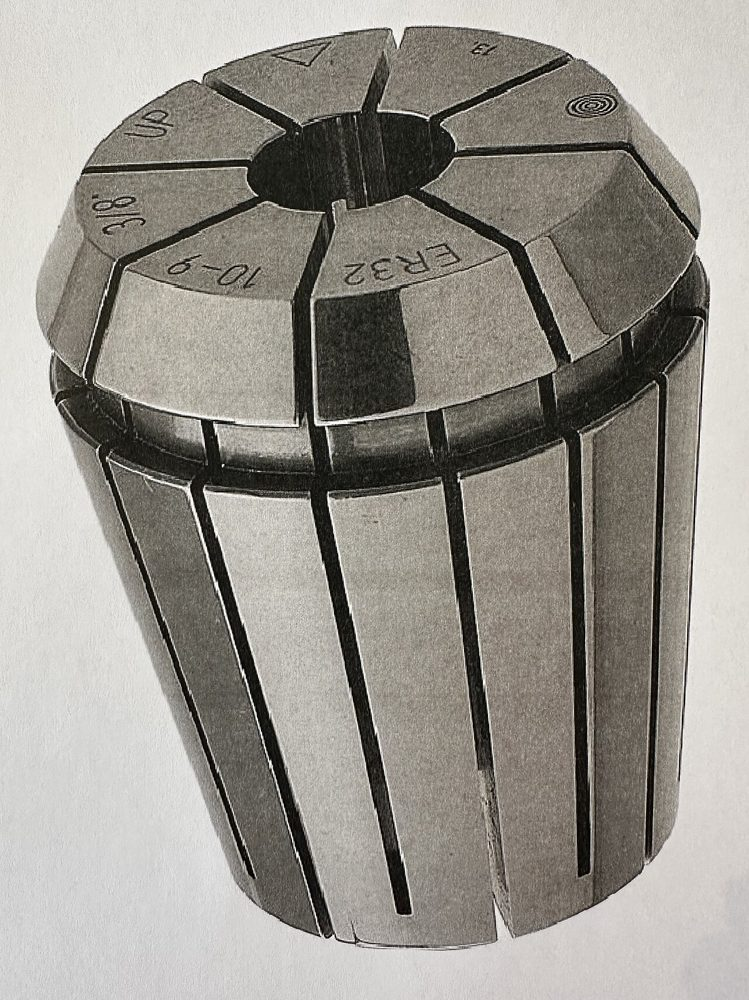

# Laguna CNC Router

!!! note "Coming soon"
    This page is still being written.

<!--
Running a job on the Laguna from stock to finished part.

!!! warning "Sign-off required"
    You must be signed off by a mentor on the router before you run it. For your first several jobs, a signed-off operator stays at the machine with you. Read [Shop Safety](../general/safety.md) first.

## When you need this

When you have a G-code file from [CAM in Fusion](cam-fusion.md) and a sheet of aluminum or polycarbonate to cut. A **CNC router** is a machine with a fast spindle that moves a cutter in X (left-right), Y (front-back) and Z (up-down) under computer control. It cuts our plates, gussets and panels much more accurately than we can by hand.

*A generic router, not a Laguna. The **gantry** is the bridge that moves front to back and carries the **spindle** (the motor that spins the cutter). The **controller** runs the machine.*

Laguna makes several router lines (SmartShop, IQ, Swift), and their controllers work a little differently. The steps below follow the Laguna IQ Pro owner's manual. Button names on our machine may differ.

!!! question "2928: fill in"
    Which Laguna model do we have, what controller (handheld controller, PC software), and what spindle (air or water cooled, collet size, automatic tool changer or manual)? Does it have a vacuum table? Replace the button names below with ours if they differ.

## Before you start

**Safety rules for the router:**

- Safety glasses and hearing protection. Routing aluminum is loud.
- No gloves, loose sleeves or jewelry near the spindle. Hair tied back.
- **Never reach over the table or into the gantry's path while the machine is powered.** The gantry moves fast and without warning.
- **Press the E-stop and turn off the power before you change a cutter** or touch the spindle (Laguna's manual says this too).
- **Never leave the router running unattended.** Aluminum chips and a stuck cutter can start a fire, and a part that breaks loose needs someone at the stop button.
- Know where the **E-stop** (big red button) is. For a normal stop, the stop or cancel button on the controller is the better choice. Use the E-stop in an emergency.
- Keep a dust collector or shop vac running when cutting plastic.

**Check before you power on:**

1. You have the right G-code file on a USB drive, and you know which cutter, which origin corner and which stock thickness it was programmed for.
2. The spoilboard is in good shape. The **spoilboard** is a sacrificial board on top of the machine table. Through cuts go slightly into it, so it protects the real table.
3. The collet and cutter are clean and the cutter isn't chipped.
4. Anything the manual says to check daily, like spindle coolant level or air pressure, is OK.

## Steps

### Turning on and homing

1. Twist the E-stop clockwise to release it, then turn on the main power.
2. **Home** the machine. On the IQ controller, accept the home prompt with **REF/OK**. Homing drives each axis to its limit switch so the machine knows where it is. It must be done every time the machine is powered on.

### Fixturing the sheet

**Fixturing** (or workholding) is holding the sheet down so it can't move or lift. If the sheet shifts even a little mid-job, every part after that is wrong.

1. Clean chips off the spoilboard.
2. Measure the sheet thickness with calipers. Make sure it matches what the CAM was set up for.
3. Place the sheet so the origin corner in the CAM is near the front-left (or wherever your setup says).
4. Hold it down:
    - **Screws** through the sheet into the spoilboard, in the margin outside the parts. This is very secure for aluminum. Make sure no toolpath passes over a screw.
    - **Clamps** on the edges. Keep them low and out of the toolpath, and remember the gantry and spindle need to clear them too.
    - **Vacuum table**, if the machine has one. Good for flat plastic sheets, less reliable for small or warped pieces.
5. Push down on the sheet in several places. It should not rock or bow. Aluminum sheet that bows up in the middle will cut too deep at the edges and not through in the middle.

!!! question "2928: fill in"
    How do we hold sheets down (screws, clamps, vacuum, double-sided tape)? Where is the screw pattern, and what screws do we use?

!!! tip "Photo needed"
    A photo of a sheet correctly screwed down on our spoilboard, with the origin corner marked.

### Loading the tool

Router cutters are held in a **collet**, a slotted sleeve that squeezes the cutter shank when the nut is tightened.

1. Press the E-stop and turn off the power before touching the spindle.
2. Pick the cutter the G-code was programmed for, and the collet that matches its shank size (1/4" shank goes in a 1/4" collet). Never put a shank in the wrong size collet.
3. Wipe the collet, nut and spindle taper clean. Sawdust or chips in the collet slots stop it from gripping evenly.
4. Snap the collet into the nut first, then thread the nut onto the spindle (or the tool holder) by hand.
5. Slide the cutter shank into the collet. Insert it far enough that most of the shank is gripped, but don't push the cutting flutes into the collet.
6. Tighten the nut with the two provided wrenches. Firm, not crazy tight.
7. Spin the cutter by hand (power off) to check it runs straight.

!!! question "2928: fill in"
    Does our router use a manual collet nut or an automatic tool changer with tool holders? What collet size do we have, and which cutters live in which holders?

### Zeroing X, Y and Z

**Zeroing** tells the machine where the origin you picked in CAM actually is on the sheet. Getting this wrong is the most common way to ruin a sheet or crash a cutter.

1. Power on again and clear any E-stop alarm on the controller.
2. Load the program. On the IQ controller, copy the file from USB to the controller's internal memory (Laguna says running directly from USB is less reliable), then open it from **FILE > Internal File**.
3. Make sure you're in the work coordinate system the program uses (Workpiece 1 on the IQ).
4. **X and Y:** jog the spindle until the center of the cutter is exactly over the origin corner from your CAM setup. Press **XY → 0**. The X and Y readouts go to zero.
5. **Z:** set the jog speed to slow. Slide a sheet of paper back and forth on top of the stock under the cutter while you jog Z down in small steps. When the cutter just catches the paper, it's about one paper thickness (about 0.1 mm) above the stock. Press **ZC → 0**. The Z readout goes to zero.
6. Press **REF/OK** to lift the spindle to a safe height.

If our machine has a touch plate or tool length sensor, use it for Z instead of paper. It's more repeatable.

Your Z zero must match the CAM. If the CAM set Z zero on the top of the stock, touch off on the top of the stock. If it was set on the spoilboard, touch off on the spoilboard.

### Running the job

1. Check one more time: right cutter, sheet held down, nothing in the gantry's path, clamps and screws clear of the toolpath.
2. Safety glasses and hearing protection on. Dust collection on.
3. Start the program (**RUN/PAUSE** on the IQ, then **REF/OK** to accept the run settings).
4. Watch the first cut closely with your hand near the stop button. If the cutter goes somewhere you didn't expect, or the cut sounds wrong (loud screaming, heavy chatter), stop the machine.
5. On the IQ you can adjust feed rate during the job (Y+ and Y- change it by 10%). Only do this if a mentor has shown you.
6. Stay at the machine for the whole job. Watch for chips piling up in the cut, parts lifting, and smoke.
7. When the job ends, wait for the spindle to stop completely and the gantry to park.

## Removing parts and cleanup

1. Press the E-stop or power off before reaching onto the table.
2. Vacuum or brush away chips. Don't blow aluminum chips around with compressed air, and don't sweep them with your hand.
3. Remove the screws or clamps and lift out the sheet.
4. Break the parts free. Cut the tabs with a deburring blade, flush-cut snips or a hacksaw. Don't bend the part back and forth to snap tabs, since that bends the part.
5. File off the tab stubs and [deburr](deburring.md) every edge.
6. Check the parts against the drawing with calipers, especially hole positions and sizes.
7. Take the cutter out and put it back in its holder or box. Clean the collet.
8. Vacuum the spoilboard and the machine. Put the leftover sheet back in stock with its thickness written on it.
9. Write down anything that went wrong (broken cutter, wrong size) so the CAM can be fixed.

## Common mistakes

- Zeroing on the wrong corner, or Z on the wrong surface.
- Not homing after power-on.
- Using a different cutter than the one in the CAM.
- A screw or clamp in the toolpath. The cutter hits it and breaks.
- Sheet not flat, so parts don't cut through in the middle.
- Leaving the machine during a job.
- Reaching onto the table while the machine is powered.
- Snapping tabs by bending the part.

## Learn more

- [Laguna IQ Pro owner's manual (PDF)](https://lagunatools.com/wp-content/uploads/2024/05/iq-pro-owners-manual-r03-v01_051724.pdf), with the quick start, origin and tool setup steps used here
- [Laguna SmartShop M owner's manual (PDF)](https://lagunatools.com/wp-content/uploads/2019/10/smartshop-m-owners-manual-r02-v09.pdf), an older controller with similar origin steps
-->
