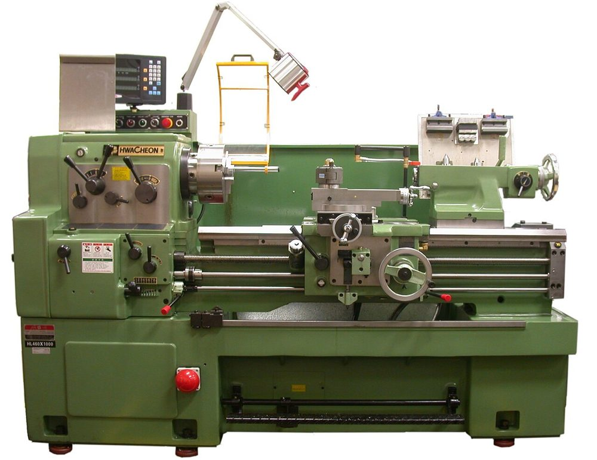

# Lathe

Turning round parts: spacers, shafts and standoffs.

!!! warning "Sign-off required"
    You must be signed off by a mentor on the lathe before you use it, and a trained person should be nearby whenever you run it. Read [Shop Safety](../general/safety.md) first.

## When you need this

Our lathe is a small **benchtop lathe** with a three-jaw chuck and a digital readout (DRO). On a lathe, the **part spins** and a fixed cutting tool moves along it. That's the opposite of a drill press or router, where the tool spins. Anything round is a lathe job. On an FRC team that means:

- Cutting hex shaft to length and facing the ends square.
- Making spacers and standoffs
- Drilling and tapping the end of a shaft so a bolt and washer can retain it
- Turning down the end of a shaft to fit a bearing.

## Safety

The lathe can hurt someone badly because the spinning chuck grabs anything that touches it.

- **Never leave the chuck key in the chuck.** Not for a second. When the spindle starts, the key flies out. Make it a habit: key in your hand or on the bench, never in the chuck.
- **No gloves, no loose sleeves, no jewelry, hair tied up.** A glove or sleeve caught by a spinning part pulls your arm in before you can react.
- **Safety glasses always.** A face shield on top is a good idea for heavy cuts.
- **Stop the spindle before you measure, adjust or clear chips.** Then wait for it to stop. Don't slow the chuck with your hand.
- **Never clear chips with your hands.** Lathe chips come off as long, sharp, sometimes hot strings. Use a chip hook or brush with the spindle stopped.
- **Don't lean on the machine or reach over the chuck** while it's running.
- **Know where the stop button is** before you start.

## Parts of the lathe

*A full-size lathe. Ours is a smaller benchtop lathe, but the parts are in the same places: headstock and chuck on the left, carriage in the middle, tailstock on the right.*

| Part | Where | What it does |
|---|---|---|
| Headstock | Left end | Holds the spindle. On ours, belts and pulleys under a cover connect it to the motor and set the speed. |
| Chuck | On the spindle, left | Grips the part and spins it. Ours is a three-jaw chuck, tightened with a chuck key. |
| Bed and ways | The long base | Precision rails the carriage and tailstock slide on. |
| Carriage | Middle, rides on the ways | Moves the tool along the part (toward and away from the chuck) with the big handwheel. |
| Cross slide | On top of the carriage | Moves the tool in and out, toward the center of the part. |
| Compound rest | On top of the cross slide | A small slide that can be set at an angle. Often used for small, precise moves. |
| Tool post | On top of the compound | Holds the cutting tool. |
| Tailstock | Right end | Slides along the ways. Holds a drill chuck or a center to support long parts. Its **quill** moves in and out with a handwheel. |
| Lead screw and feed rod | Along the front | Drive the carriage automatically for power feed and threading. |
| Dials and DRO | On each handwheel, and a digital readout | Show how far you've moved the tool. Our DRO runs on batteries, so **turn it off when you're done**. |

!!! question "2928: fill in"
    What lathe do we have (make, model)? Does the DRO read diameter or radius on the cross slide? Where are the belt speed chart, the stop switch and the chuck key kept? A labeled photo of our lathe would replace the generic one above.

## Setup

### Changing the speed

Our lathe changes speed by moving the belts to different pulleys. Each pulley combination gives one spindle speed. A chart on the machine shows which belt positions give which speed.

1. Turn the lathe off and unplug it. The belts and pulleys are right next to the motor.
2. Open the belt cover.
3. Loosen the belt tension so the belts slide off the pulleys easily.
4. Look up the speed you want on the chart and move the belts to those pulleys. Pick the closest speed **at or below** what you calculated.
5. Tighten the tension again. The belts should be snug, not slipping, but not drum-tight.
6. Close the cover, plug the lathe back in.

!!! question "2928: fill in"
    How is belt tension loosened on our lathe (lever, knob, motor mount bolts)? A photo of the pulleys and the speed chart would help here.

### Chucking the part

1. With the lathe off, open the chuck jaws a little wider than the part.
2. Put the part in. Keep as little sticking out as you can, generally no more than about three times its diameter without support from the tailstock. A long part sticking out bends away from the tool and chatters.
3. Tighten with the chuck key, using each key socket in turn so the jaws close evenly. The three-jaw chuck centers itself, so it grips **round and hex stock** well. For hex, put each jaw on every other flat.
4. **Remove the chuck key.**
5. Turn the chuck by hand one full revolution. Check that nothing hits the jaws, the tool or the carriage, and that the part runs reasonably true.
6. Work out the speed with the formula on [Machining Basics](machining-basics.md#speeds-and-feeds-in-plain-words), using the **part's** diameter, since the part is what spins. A 1" aluminum part at 250 SFM with an HSS tool works out to about 950 RPM. Then set the belts (see [Changing the speed](#changing-the-speed)).
7. Turn on the DRO.

### Checking tool height

The tip of the cutting tool must be exactly at the **centerline** of the part, the same height as the center of the spindle. Our tools are already set on center in their holders, but it's good to check before you cut.

- **Too high**: the tool rubs instead of cutting and leaves a rough finish.
- **Too low**: the tool digs in and can pull under the part. When facing, it leaves a small nub in the middle.

To check: bring the tool tip up to the point of a center in the tailstock and compare heights, or face the end of the part and look for a nub in the middle. If the tool isn't on center, tell a mentor rather than adjusting it yourself.

## Operations

### Facing

Facing cuts the end of a part flat and square. Do this first on every part, so you have a clean reference to measure from.

1. Put a facing or turning tool in the tool post, angled slightly so only its tip touches the end.
2. Lock the carriage to the ways so it can't drift.
3. Start the spindle. Bring the tool to the outside edge of the part.
4. Move the tool a few thousandths toward the chuck with the compound or carriage.
5. Crank the cross slide steadily so the tool moves from the outside to the center.
6. Take light passes until the whole end is clean.

### Turning

Turning makes the outside diameter smaller.

1. Unlock the carriage. Set the tool for a cut a few thousandths deep with the cross slide.
2. Start the spindle. Move the carriage toward the chuck by hand (or with power feed once you're trained).
3. Stop before the tool reaches the chuck jaws. Mark that spot or set a carriage stop.
4. Back out, stop the spindle, measure with calipers, and take the next pass.
5. Take smaller passes as you get close to size. Leave the last pass light (a few thousandths) for a good finish.

On many lathes, moving the cross slide in 0.010" takes 0.020" off the diameter, because the tool cuts both sides of the spinning part. Some dials and DROs are set to read diameter directly. Find out which ours does before you rely on it, and always check the part with calipers.

### Drilling and boring

Drilling on the lathe puts a hole exactly on the center of a shaft. This is how you make a hole to tap the end of a hex shaft.

1. Face the end first.
2. Put a **center drill** in the tailstock drill chuck. Slide the tailstock up close to the part and lock it.
3. Start the spindle and feed the center drill in with the tailstock handwheel until the cone is a bit wider than your drill. This starts the hole exactly on center.
4. Switch to the real drill. Use a slower spindle speed for bigger drills.
5. Feed in, pulling back often to clear chips (pecking). Use cutting fluid.
6. For a tapped hole, you can start the tap straight using the tailstock to guide it, with the spindle **off**. Turn the chuck by hand or turn the tap wrench.

**Boring** opens up a hole with a single-point tool on a bar that reaches inside the part. It's used for accurate bearing bores. Ask a mentor to show you before trying it.

### Parting off

Parting cuts the finished part off the stock with a thin blade-shaped tool. It's the operation most likely to go wrong, so go carefully.

1. Part off as close to the chuck as you can, ideally within about 1/8" of the jaws. That keeps the setup stiff.
2. The parting tool must be exactly on center and square to the part.
3. Use a slower speed than for turning, and lots of cutting fluid.
4. Feed in steadily with the cross slide. Don't stop and start, and don't let it rub. If it chatters or squeals, back out and check the tool.
5. Never part off with the tailstock supporting the end. The part gets trapped and the tool jams.
6. Let the part fall off. Don't try to catch it while the spindle is turning.

## When you're done

1. Stop the spindle and wait for it to stop.
2. **Turn off the DRO.** It runs on batteries and drains them if it's left on.
3. Take the part out of the chuck. Put the chuck key back where it lives.
4. Clean chips off the ways, carriage and chuck with a brush, never your hands.

## Common mistakes

- Leaving the chuck key in the chuck.
- Leaving the DRO on, so the batteries are dead next time.
- Changing belts with the lathe still plugged in.
- Too much stock sticking out of the chuck.
- Tool not on center, leaving a nub on faced ends.
- Forgetting the dial may read radius, so the part ends up twice as undersize as you meant.
- Reaching for chips while the spindle is still turning.
- Parting off far from the chuck, so the tool digs in and snaps.

## Learn more

- [OSHA: Introduction to the lathe (trainer script)](https://www.osha.gov/sites/default/files/2021-04/Lathe%20-%20Trainer%20Script.pdf)
- [Artisan's Asylum: intro to the metal lathe](https://wiki.artisansasylum.com/wiki/Intro_to_the_metal_lathe)
- [University of Florida: parting on the lathe](https://web.mae.ufl.edu/designlab/Advanced%20Manufacturing/Lathe%20Parting/Parting%20on%20Lathe.htm)
- [Open Oregon: Manufacturing Processes, Lathe chapter](https://openoregon.pressbooks.pub/manufacturingprocesses45/?p=197)
