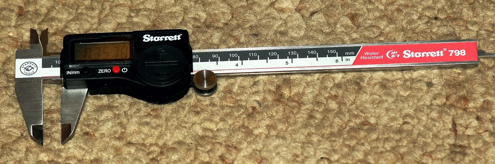
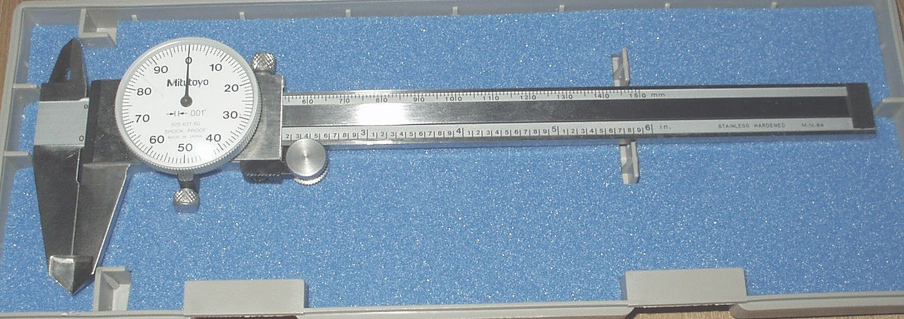
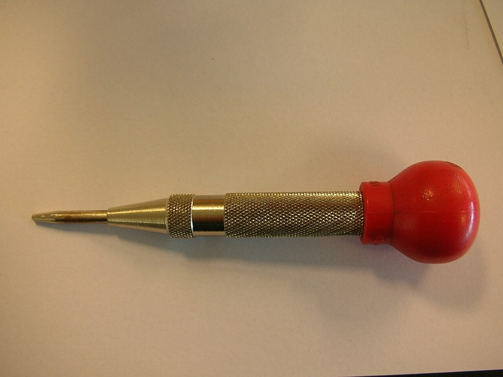

# Machining Basics

The vocabulary and habits you need before touching any machine.

## When you need this

Read this before your first shop session. Every other machining page assumes you can measure a part, mark where a hole goes, hold the part so it can't move, and read the drawing that tells you what to make. Some basic rules that apply to any machining are listed below:

- Safety glasses on whenever anything in the shop is running, not only your machine.
- **NO GLOVES** on anything that spins (drill press, lathe, grinder, router). A glove can catch and pull your hand in.
- Tie back long hair, roll up or remove loose sleeves, and take off rings, watches and necklaces.
- Clear chips with a brush, never your hand. Aluminum chips are sharp enough to cut you.
- Stop the machine before you measure, adjust or reach in.

## Measuring and marking

### Calipers

Calipers measure outside sizes (a plate's thickness), inside sizes (a hole) and depths. Most shop calipers read to 0.001" (one thousandth of an inch, called "one thou").

*A digital caliper. The IN/mm button switches units, so check that it says inches before you read it.*

*An inch dial caliper. Each mark on the dial is 0.001", and one full turn is 0.100".*

The parts you need to know:

- **Outside jaws** (the big ones at the bottom) measure thickness and outside diameter.
- **Inside jaws** (the small ones at the top) measure holes and slots.
- **Depth rod** slides out of the end to measure the depth of a hole or step.
- **Thumb wheel** moves the jaw. **Lock screw** holds it in place.

How to measure:

1. Wipe the jaws clean and close them. A digital caliper should read 0.000. On a dial caliper, the needle should point to 0. If it doesn't, loosen the bezel lock, turn the dial face to 0, and lock it again.
2. Open the jaws wider than the part, then close them onto it with light, steady pressure. Squeezing hard tilts the jaws and gives a smaller number.
3. Keep the part deep in the jaws and square to them. Measuring with just the tips, or at an angle, gives a wrong reading.
4. Read the number while the jaws are still on the part.

Reading a dial caliper takes two numbers. The bar scale shows tenths of an inch (0.100"). The dial shows thousandths, and one full turn of the needle is 0.100". Read the last tenth mark the jaw has passed on the bar, then add the dial reading. If the jaw has passed the 0.300 mark and the needle points at 47, the part is 0.347".

!!! tip
    Measure twice, cut once. You can always remove move material, but you can never put it back.

### Scribes and layout fluid

**Layout** means drawing the part's lines and hole locations onto the stock before you cut. On metal, a pencil line is too thick and rubs off, so we **scribe, a hardened steel point that scratches a thin line.

1. Clean the stock. Paint a thin coat of **layout fluid** (blue or red dye, often called Dykem) where you'll mark. A permanent marker works for rough layout.
2. Let it dry for a minute.
3. Measure from a finished, square edge. Use a combination square or height gauge to hold the scribe at the right distance, and pull the scribe toward you in one pass.
4. Where two lines cross is where a hole goes.

The scratch shows bright silver through the dye, so it's easy to see and accurate to a few thousandths.

### Center punch

A drill bit wanders on flat metal. A **center punch** makes a small cone-shaped dent that the drill tip drops into, so the hole starts where you marked it.

1. Put the punch tip exactly on the crossing of your two layout lines. Look from two directions to check.
2. With a regular punch, hold it straight up and give it one firm tap with a hammer. With an **automatic center punch** (like the one above), just push down until it clicks.
3. Check the dent is on the crossing. If it's a little off, angle the punch toward where it should be and tap again to move it, then straighten up and tap once more.

## Speeds and feeds in plain words

**Speed** is how fast the tool or the part spins, in RPM (revolutions per minute). **Feed** is how fast the tool moves into the material. Get them right and you get clean chips, a good finish and a sharp tool. Get them wrong and you burn the tool, melt plastic or break a bit.

Each material has a **cutting speed**: how fast the cutting edge can move across it, in surface feet per minute (SFM). Soft materials like aluminum allow a high cutting speed. Hard materials like steel need a slow one. To turn that into RPM:

**RPM = (cutting speed in SFM x 3.82) / tool diameter in inches**

Typical starting cutting speeds for high-speed steel (HSS) tools, from the [University of Florida design lab speeds and feeds page](https://web.mae.ufl.edu/designlab/Advanced%20Manufacturing/Speeds%20and%20Feeds/Speeds%20and%20Feeds.htm):

| Material | Cutting speed (SFM) |
|---|---|
| Aluminum | 250 |
| Delrin (acetal) | 250 |
| Mild steel | 100 |

Example: a 1/4" drill in aluminum. 250 x 3.82 / 0.25 = 3,820 RPM. Many drill presses don't go that fast, so you use the fastest setting you have. The same drill in mild steel works out to about 1,500 RPM.

Some rules of thumb that follow from the formula:

- **Bigger tool, slower speed.** A 1/2" drill needs half the RPM of a 1/4" drill.
- **Harder material, slower speed.** Steel runs at roughly 40% of the aluminum speed.
- **Feed steadily.** You should see real chips curling off. If you just get dust or squealing, you are rubbing, not cutting, and rubbing dulls the tool fast.
- **Burning smell, smoke or blue chips** means too fast or not enough cutting fluid. Slow down.

## Holding the work

Every part must be clamped. A part held by hand can grab and spin on a drill press, and a spinning plate will cut you. This is the most common way people get hurt on a drill press.

| Tool | Use it for |
|---|---|
| Drill press vise | Small parts and short pieces of tube on the drill press. |
| C-clamps or quick clamps | Plates too big for the vise. Clamp to the table with a scrap board underneath. |
| Bench vise | Hand work like filing, tapping and deburring. |
| Lathe chuck | Round stock on the lathe. |
| Screws, clamps or vacuum | Sheets on the CNC router. |

Put a piece of scrap wood or aluminum under anything you drill through, so the bit doesn't drill into the vise or table. Use soft jaws (aluminum or plastic jaw covers) when you don't want the vise to mark a finished part.

## Reading a drawing

A **drawing** is a 2D picture of a part with all the sizes on it. Mentors and designers make drawings from Onshape so you don't have to guess.

- **Views.** Most drawings show the front, top and side of the part. Each view is the part seen from one direction. Find the same feature in two views to understand its shape.
- **Dimensions.** Every size you need is written on the drawing. Don't measure the printed picture with a ruler. If a size is missing, ask.
- **Units.** Check the title block (the box in the corner). Most FRC drawings are in inches, but a part cut in the wrong units is scrap, so always check.
- **Tolerances.** A tolerance is how far off you're allowed to be. "0.500 ± 0.005" means anything from 0.495" to 0.505" is fine. The title block often has a general tolerance for sizes without their own.
- **Hole callouts.** A note like "4X Ø0.201 THRU, 1/4-20 TAP" means four holes, drilled 0.201" all the way through, then tapped for a 1/4-20 screw. "4X" means "this happens 4 times."
- **Material and quantity.** Usually in the title block. Check you have the right stock before you cut.

!!! question "2928: fill in"
    Where do students find drawings for the current robot (printed binder, Onshape link, a shared folder)? Who makes them, and what is our standard general tolerance?

## Common mistakes

- Measuring with the caliper tips instead of deep in the jaws.
- Skipping the center punch and getting a hole that "walked" off the mark.
- Holding a part by hand on the drill press "just for one hole."
- Running a big drill at the same speed as a small one.
- Wearing gloves near a spinning tool.
- Cutting from the drawing without checking whether it's in inches or millimeters.

## Learn more

- [University of Florida design lab: speeds and feeds](https://web.mae.ufl.edu/designlab/Advanced%20Manufacturing/Speeds%20and%20Feeds/Speeds%20and%20Feeds.htm), with the cutting speed table used above
- [Travers Tool: how to read a dial caliper](https://solutions.travers.com/metalworking-machining/measuring-inspection/how-to-read-a-dial-caliper)
- [AJAC: Dial Caliper 101](https://www.ajactraining.org/blog/dial-caliper-101/), with a short video
- [FIRST: FRC tool recommendations](https://community.firstinspires.org/hubfs/web/program/frc/resources/frc-tool-recommendations.pdf), covering basic measuring and workholding tools
