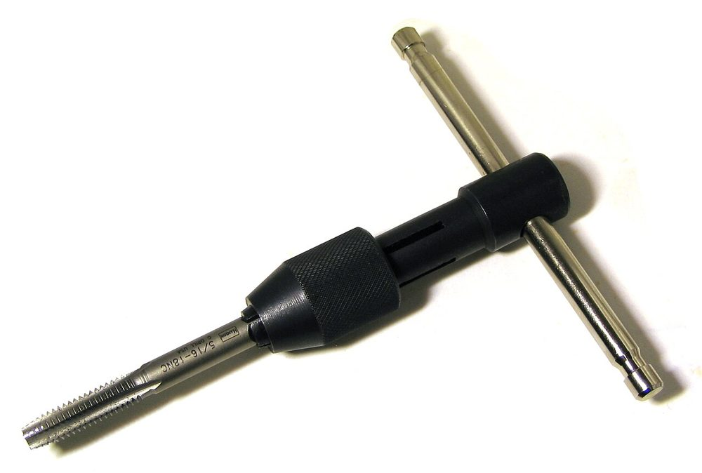
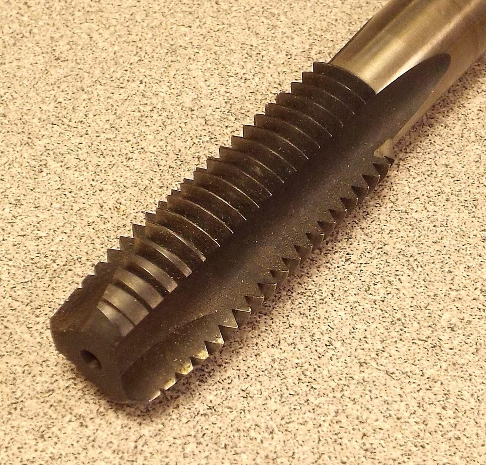

# Tapping

Cutting threads into a hole by hand.

!!! warning "Sign-off required"
    Tapping by hand doesn't use a powered machine, but you still need a mentor sign-off before tapping robot parts. Tapping with a hand drill or in the lathe is only done with a mentor or experienced machinist present.

## When you need this

Whenever a screw threads straight into a part instead of a nut: the ends of hex shaft, standoffs, the ends of tube plugs, bearing blocks and Delrin spacers. A **tap** is a hardened steel tool shaped like a screw with grooves cut along it. Turned into a drilled hole, its cutting edges cut matching threads into the walls.

Thread names tell you the size. **10-32** means a #10 screw (about 0.190" across) with 32 threads per inch. **1/4-20** is a 1/4" screw with 20 threads per inch. Metric threads like **M5x0.8** give the diameter (5 mm) and the distance between threads (0.8 mm).

## Tap drill sizes

The hole must be smaller than the screw so there's metal left for the threads. That hole size is the **tap drill**. Too big and the threads are shallow and strip. Too small and the tap jams and breaks.

We only use cutting taps, so the table below lists the standard 75% thread drill for each size.

| Thread | Tap drill | Close-fit clearance drill |
|---|---|---|
| 6-32 | #36 (0.1065") | #27 (0.144") |
| 8-32 | #29 (0.136") | #18 (0.1695") |
| 10-24 | #25 (0.1495") | #9 (0.196") |
| 10-32 | #21 (0.159") | #9 (0.196") |
| 1/4-20 | #7 (0.201") | F (0.257") |
| M3x0.5 | 2.5 mm | |
| M4x0.7 | 3.3 mm | |
| M5x0.8 | 4.2 mm | |

Source: [Little Machine Shop's tap drill chart](https://www.littlemachineshop.com/reference/tapdrill.php) (metric sizes are the standard "diameter minus pitch").

The **clearance** column is the hole a screw passes through without threading in, like the hole in the plate you're bolting on. In Onshape, the Origin Cube FeatureScript has variables for tap and clearance sizes (see [Getting Started](../cad/getting-started.md)).

In FRC, 10-32 and 1/4-20 are by far the most common. 10-32 is the standard for bolting structure together, and 1/4-20 shows up in shaft ends and bigger brackets.

## Tap types

Taps also come as **taper**, **plug** and **bottoming**. That describes how many threads at the tip are ground down to start the cut. A taper tap starts easiest. A bottoming tap threads almost to the bottom of a blind hole. **Blind** means the hole has a bottom; **through** means it goes all the way through.

### Spiral point

Also called a gun tap. The tip is ground at an angle that shoots chips **forward**, ahead of the tap. Use it for **through holes**, where the chips fall out the bottom. It's strong and you can usually tap straight through without backing up. Don't use it in a blind hole: the chips pack into the bottom and the tap jams.

### Spiral flute

The grooves twist around the tap like a drill bit and pull chips **up and out** of the hole. Use it for **blind holes**. Spiral flute taps are a bit weaker than spiral point taps, so go gently.

!!! note
    You may see **thread-forming** (roll) taps online. They press threads instead of cutting them and need a different, bigger drill size. We don't use them, so if you find one in a drawer, ask a mentor before using it.

## Steps

1. Check the drawing for the thread size and depth.
2. Drill the tap drill from the table. Use the drill press so the hole is straight. Make blind holes deeper than the threads need, since the last few threads of a tap are tapered.
3. Lightly countersink or chamfer the hole. This helps the tap start and stops a raised burr around the hole.
4. Clamp the part in a vise so the hole is vertical.
5. Put the tap in a **tap wrench**: a T-handle for small taps or a two-handled bar wrench for bigger ones.
6. Add tapping fluid. In aluminum, cutting fluid or WD-40. In steel, cutting oil. Plastics usually need none.
7. Start the tap **straight**. A tap guide (a block with a hole that holds the tap vertical) or a spring center in the drill press chuck makes this much easier. Check it's square from two directions after the first couple of turns.
8. Turn clockwise. With a cutting tap, use the classic rhythm: about half a turn forward, a quarter turn back to break the chip. With a spiral point tap in a through hole in aluminum, you can usually turn steadily.
9. If it suddenly gets hard to turn, stop. Back the tap out, clean the chips, add fluid and try again. Forcing it is how taps break.
10. In a blind hole, feel for the bottom and stop. Don't force the last turn.
11. Back the tap out, blow or brush out the chips, and test the thread with a screw.

!!! tip
    Hand-tapping 1/4-20 and larger takes real force. Keep both hands on the wrench and push evenly, so you don't bend the tap sideways. Most broken taps break from side-to-side force, not from turning.

## Tapping with a hand drill or the lathe

Almost all of our tapping is done by hand. Power tapping is fast, but a tap under power can snap in an instant, and it's easy to drive it crooked. We only do it rarely, and **only with a mentor or experienced machinist present**.

- **Lathe.** For a threaded hole centered on the end of a turned part, like a shaft end. The tap is held in the tailstock (in a drill chuck or a tapping guide) so it stays lined up with the part. The spindle stays **off**, and you turn the chuck or the tap wrench by hand. See [Lathe](lathe.md#drilling-and-boring). 

## Removing a broken tap

A broken tap is hardened steel, harder than a drill bit. You can't drill it out with a normal drill. Tell a mentor right away, and don't keep poking at it, since that often makes it worse.

Options, roughly in the order a mentor will try them:

1. **Grab the stub.** If a piece sticks out, grip it with pliers and turn it out counterclockwise, gently.
2. **Tap extractor.** A tool with thin steel fingers that slide down the tap's flutes, so you can turn the broken piece out. It only works if the tap isn't jammed tight.
3. **Shatter the tap** Sometimes, you can strike the stuck tap with a centerpunch to crack it, then pull out the pieces.
4. **Remake the part.** For most FRC parts, it's faster to make a new one.

## Common mistakes

- Using the wrong size drill. Check the table, and don't guess from what looks close.
- Starting the tap crooked, so the screw goes in at an angle.
- Tapping dry.
- Forcing a tap that's getting stiff instead of backing it out to clear chips.
- Tapping before deburring, so a burr gets pushed into the threads.

## Learn more

- [Little Machine Shop: tap drill chart](https://www.littlemachineshop.com/reference/tapdrill.php), with a printable PDF
- [Caltech: tap and drill sizes](https://leech.caltech.edu/cntl/?p=306), a second chart
- [Hackaday: dissolving steel drill bits with alum](https://hackaday.com/2015/08/03/dissolve-steel-drill-bits-in-alum-from-the-grocery)
