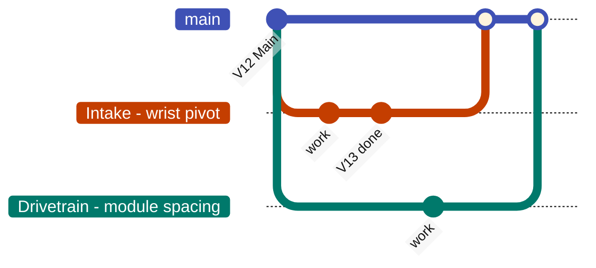

# Rule 2: Never Work in Main

**The rule:** Nobody edits the Main workspace. All changes are made on a branch created for that piece of work. When the work is finished and reviewed, the branch is merged into Main.

## What it means

Every Onshape document has a default workspace called **Main**. A **branch** is your own copy of the document, where you can change things without touching anyone else's view. When you finish, you **merge** your branch back into Main.

- You don't open Main to "just fix one thing." You make a branch first, even for small changes.
- One branch is for **one job** (the "scope"), such as adding a wrist pivot to the intake. Don't mix unrelated changes in one branch if possible.
- A mentor or subsystem lead looks over the changes before they're merged.
- Main always holds the last reviewed state of the document.

## Why

- **Other documents stay stable.** The robot assembly pulls parts from this document. If Main changed every time someone edited it, the assembly would keep shifting for everyone using it. Since Main only changes when we merge, everyone gets the update at once, when we're ready for it.
- **Mistakes stay small.** A broken sketch on your branch only affects you. On Main, it affects everyone.
- **People can work at the same time.** Two people can redesign two different mechanisms without waiting on each other.
- **Someone else checks your work.** Every merge gets reviewed, so problems get caught before they reach Main.
- **You can always go back.** Onshape keeps versions and history, so a bad branch can be thrown away and the document is untouched.

## How

### Name the branch well

A branch name should tell a teammate what it was for. We use this pattern:

**Subsystem - what you're changing**

Use the description field for the details.

| Good | Why |
|---|---|
| Intake - wrist pivot | Names the subsystem and the job. |
| Drivetrain - module spacing update | Specific, easy to find in the history. |
| Elevator - carriage bearing fix | Says it's a fix and what it fixes. |

| Avoid | Why |
|---|---|
| Branch 3 | Says nothing. |
| Kevin's changes | Doesn't say what the changes are. |
| test | Never gets cleaned up. |

### Create a branch

1. Open the document and open the **Versions and history** panel.
2. Make sure there's a version of Main to start from. If the latest state of Main isn't saved as a version, ask a mentor or create one: use the create version option in the panel and name it clearly, such as "V12 - before wrist pivot".
3. Right-click that version and choose **Branch to create workspace**.
4. Type the branch name and a short description.
5. Click **Create**. Leave the option to open the new workspace checked.
6. Look at the top of the screen and confirm the workspace name shows your branch, not Main. Do your work only after this check.

!!! note "Screenshot to add"
    The Versions and history panel with the right-click menu showing Branch to create workspace.

### Work on the branch

- Save your progress by making versions on the branch at natural stopping points. They're your undo points.
- If Main has changed since you branched, merge Main into your branch now and then so you stay current.

### Review the changes before merging

1. In Versions and history, find your branch and the Main version it came from.
2. Use the **Compare** option to compare your workspace with its starting version or with Main. Onshape highlights what was added, changed or removed.
3. Walk the changes with your reviewer. Check that Rules 1, 3 and 5 are followed: Origin Cube is first, geometry is in master sketches, and dimensions use functions.

!!! note "Screenshot to add"
    The compare view showing changed parts highlighted.

### Merge into Main

1. On your branch, create a final **version** (for example "V13 - wrist pivot done"). Merge from a version, not a half-finished workspace.
2. Switch to the **Main** workspace, so Main is the active workspace.
3. In Versions and history, right-click the version of your branch and choose **Merge into current workspace**.
4. Read the merge window. You choose between keep and replace options, and you can use **Compare with base** to see exactly what will change.
5. Confirm the merge. Onshape adds a merge entry to Main's history.
6. Check that Main looks right, then let the team know it's merged.

!!! note "Screenshot to add"
    The merge window with Compare with base visible.

### Common mistakes

- Editing without checking which workspace is open. Look at the top of the screen first, every time.
- Branches that sit for weeks and drift far from Main. Merge Main into your branch often, and finish branches quickly.
- Merging unreviewed work "because it's small."
- Several unrelated jobs in one branch, which makes review hard.

### More to read

- [Onshape: branching and merging help](https://cad.onshape.com/help/Content/merge.htm)
- [Onshape: Versions and history](https://cad.onshape.com/help/Content/Document/versions_and_history.htm)
- [Onshape tech tip: a guide to successful merging](https://www.onshape.com/en/resource-center/tech-tips/tech-tip-a-guide-to-successful-merging-in-onshape)

**Next:** [Rule 3: Master Sketches](03-master-sketches.md)
