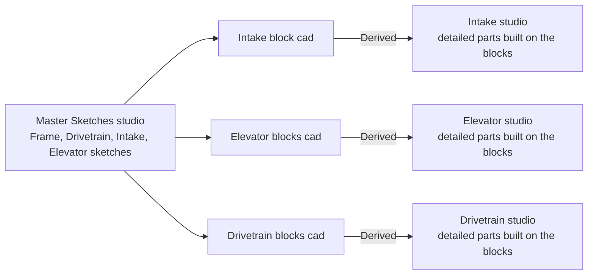

# Rule 3: Start With Master Sketches

**The rule:** Start with master sketches. Put as much of the robot's geometry as possible into one set of well-named sketches before anyone builds 3D parts. Split into more than one master sketch only when a single one gets too cluttered, and do not split further than you need.

## What it means

A **master sketch** is a 2D sketch that lays out the robot: the frame perimeter, axle centers, bearing locations, pivot points, belt and chain paths, and the space set aside for electronics and the battery. It is a floor plan for the robot, drawn before any components are created.

Master sketches live together in one Part Studio. Each subsystem's master sketch is turned into **block CAD**: simple, accurate 3D shapes for that subsystem ([Rule 4](04-block-cad.md)). The blocks, not the sketches, are what other Part Studios derive and build their detailed parts on. That way most geometry on the robot still traces back to the master sketches, through the blocks.

The [2026 robot document](https://cad.onshape.com/documents/c41e5b5e0489e0e9413cd997/w/2ffbdb1c9cd280eb809d5198/e/99871744b623f46b84ba0ae9) is the model to follow. Open it and look at how the layout is drawn first and the parts come second.

## Why

- **One place for the truth.** If the intake axle is at one spot in the master sketch, every part that uses that axle agrees on it. Without this, two people place the same axle in two slightly different places and the parts do not fit.
- **Conflicts show up early.** When all subsystems are drawn together, you can see that the elevator and the intake want the same space before any 3D work is wasted.
- **A starting point for everyone.** When a new teammate begins a part, the master sketch tells them where it goes and how big it can be.
- **Changes flow through.** Moving something in the master sketch updates the blocks built from it, and every detailed part built on those blocks.
- **It matches how good FRC teams work.** FRCDesign.org teaches this as top-down design and layout sketches. Start with the whole robot, then work down to the parts.

## How

1. **Make a Part Studio called "Master Sketches."** Put Origin Cube first ([Rule 1](01-one-origin.md)).
2. **Sketch the big things first.** Start with the frame perimeter and the major axle and pivot centers. Sketch in 2D on the standard planes, for example a side view on the Right plane and a top view on the Top plane.
3. **Use the Origin Cube functions for dimensions.** Use them for gear, pulley and center distance values so the sketch carries meaning ([Rule 5](05-smart-dimensions.md)).
4. **Name every sketch.** Click the name in the feature list and rename it. Use this pattern:
    - **Subsystem - view**, such as "Intake - side", "Frame - top" or "Drivetrain - side."
    - Never leave a sketch named "Sketch 14."
5. **Group them.** Put each subsystem's sketches in a folder in the feature list so the list stays readable.
6. **Fully define each sketch.** If a sketch still has loose lines that can move, finish constraining it before others rely on it. Leave fillets out of master sketches; add them to the 3D part at the end.
7. **Build blocks from them.** Turn each subsystem's master sketch into block CAD, as described in [Rule 4](04-block-cad.md). Subsystem Part Studios add Origin Cube first, then use **Derived** to bring in the **blocks** they need and build detailed parts on them. Derive a master sketch directly only when there is no block that carries the geometry you need.
8. **Split carefully.** If one master sketch is so crowded you cannot select anything, split it, usually by subsystem or by view. Stop there. Each extra master sketch cannot be constrained to the others as easily, so the more you split, the more of the benefit you lose.

!!! note "Screenshots and video to add"
    - The Master Sketches feature list showing named sketches in subsystem folders.
    - The Derived feature dialog pulling the intake blocks into the Intake studio.

### Common mistakes

- Starting 3D parts before the layout exists.
- Drawing the same feature again in a subsystem studio instead of deriving it.
- Sketches named "Sketch 3" and "Sketch 4".
- Splitting into one sketch per part, which defeats the point.

### More to read

- [FRCDesign.org Learning Course](https://frcdesign.org/learning-course/), Stage 1 section D: Top Down Design and Layout Sketch
- [FRC design slides: robot organization and primary sketches](https://docs.google.com/presentation/d/1r39MTWGvlD8HhafLA1El1IUdSItXruq4xSPc8Zk4OFY/htmlpresent)

**Next:** [Rule 4: High Fidelity Blocks](04-block-cad.md)
