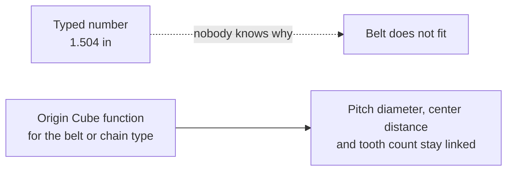

# Rule 5: Use Functions, Never Typed Dimensions

**The rule:** When you build master sketches and derived sketches, use the variables and functions that Origin Cube provides for your dimensions. That covers hole sizes, center-to-center distances, pitch diameters, gears, pulleys, belts and chains. **Never just type a diameter for a power train.**

## What it means

A dimension should tell the next person what it is. A plain number like 1.504 in does not. A named variable or a function does.

Origin Cube adds these helpers to your Part Studio:

- **Variables for fastener holes**, in imperial and metric: tap size, close fit, clearance fit and heat-set insert holes. They are named like `ClearanceFit_10_24` or `TapSize_M3`.
- **Functions for belts and chains**: 3 mm belts, 5 mm belts, RT25 belts, #25 chain and #35 chain. They work out values such as pitch diameters and center distances from the numbers you give them.
- **Outside-diameter offsets for gears and sprockets**: `GearOD_20DP_Offset`, `GearOD_32DP_Offset`, `SprocketOD_25_Offset` and `SprocketOD_35_Offset`. Each is the amount you add to the pitch radius to get the outside radius. Gears get only these offsets so far, not center distance functions.
- **A few FRC values** for MK4i swerve modules: `MK4i_Chassis2Ground_Clearance` and `MK4i_TubeOffset`.

### Fastener hole variables

There are four families. Pick the family by what the hole does, then pick the size by the screw.

| Family | Name starts with | Use it for |
|---|---|---|
| Tap size | `TapSize_` | A threaded hole the screw screws into. The value is the drill size for the thread. |
| Close fit | `CloseFit_` | A hole the screw passes through with little play. |
| Clearance fit | `ClearanceFit_` | A hole the screw passes through freely. |
| Heat-set insert | `HSI_` | A hole in a 3D-printed part that a heat-set insert is pressed into. |

How to read the size at the end of a name:

- Numbers separated by an underscore are the screw size and thread count. `10_24` is #10-24.
- The letter `d` stands for the fraction line. `1d4_20` is 1/4"-20 and `5d16_18` is 5/16"-18.
- The letter `p` stands for a decimal point. `M3p5` is M3.5.
- Heat-set insert names have only the screw size, such as `HSI_10`, `HSI_1d4` and `HSI_M3`.

Values for the screws we use most, so you can sanity check a hole. You never type these numbers. Use the variable.

| Screw | Tap size | Close fit | Clearance fit | Heat-set insert |
|---|---|---|---|---|
| #10-32 | 0.159 in | 0.196 in | 0.201 in | `HSI_10`: 0.257 in |
| #10-24 | 0.150 in | 0.196 in | 0.201 in | `HSI_10`: 0.257 in |
| 1/4"-20 | 0.201 in | 0.257 in | 0.266 in | `HSI_1d4`: 0.316 in |
| 5/16"-18 | 0.257 in | 0.323 in | 0.332 in | none |
| M3 | 2.7 mm | 3.15 mm | 3.30 mm | `HSI_M3`: 4 mm |
| M4 | 3.5 mm | 4.2 mm | 4.5 mm | `HSI_M4`: 5.6 mm |
| M5 | 4.5 mm | 5.25 mm | 5.25 mm | `HSI_M5`: 6.5 mm |

See them in use in the [Origin Cube example document](https://cad.onshape.com/documents/321c197a842fc5f1a29e6621/w/fc3cdd5ca7edcd93e02f13cc/e/5abed6fb539ec4f242fdc565).

## Why

- **Anyone can read the intent.** Seeing a function for a #25 chain sprocket tells a reader what the circle is meant to represent. A typed number makes them guess, or measure.
- **The math is done for you.** Pitch diameter, center distance and tooth count are linked. Typing a diameter by hand is how a belt ends up not fitting.
- **Changes flow through.** Change a tooth count or a center distance and everything driven by it updates.
- **The right hole for the job.** Using the named variable for a clearance, tap or insert hole means the same screw gets the same size hole on every part.
- **Other tools can use the sketch.** Belt & Chain Gen reads the pitch diameter from your sketch and updates the tooth count to match. It only works well if the sketch is built from the functions.

## How

1. **Start with Origin Cube first ([Rule 1](01-one-origin.md)).** Leave **All functions** and **All variables** on. They are on by default. If you ever turn them off, you can still pick groups: Standard bolt fits, Heatset inserts and FRC related for variables, and the belt, chain and gear groups for functions. A Part Studio without them has no variable list to choose from.
2. **Pick the dimension tool.** Click the sketch line or circle you want to size.
3. **Enter an expression instead of a number.** In the dimension box, start with `=`. Typing `#` lists the variables in the Part Studio, including everything Origin Cube added. Pick the one that matches the job.
4. **For fastener holes, answer two questions.**
    - **What does the hole do?** A thread the screw screws into: `TapSize_`. A screw that passes through: `ClearanceFit_`, or `CloseFit_` when you want it snug. A 3D-printed part with an insert: `HSI_`.
    - **Which screw?** Match the size to the end of the name. A plate hole for a #10-32 bolt to pass through is `#ClearanceFit_10_32`. A hole in aluminum that gets a 1/4"-20 thread is `#TapSize_1d4_20`. An M3 insert in a print is `#HSI_M3`.
5. **For power trains, build from the function.** Size the pulley or sprocket circle with the function for its belt or chain type, and set the center-to-center distance with the matching center distance function. For the outside circle of a gear or sprocket, add the matching `OD_Offset` variable to the pitch radius. Do not type a diameter or a distance.
6. **Generate parts from the sketch.** Belt & Chain Gen reads the pitch diameter from your sketch circle and sets the tooth count. See [Getting Started](../getting-started.md) for installing it.
7. **Check your work.** Click each dimension. It should show an expression or variable name, not a bare number. Replace any bare number on a power train or a fastener hole.

!!! note "Screenshots and video to add"
    - A sketch dimension box showing the `#` variable list.
    - A sprocket circle whose diameter comes from a chain function.

### What can be a plain number

A function is not always needed. These are fine as typed numbers:

- A size taken from the rules, such as a bumper zone, if there is no named variable.
- Frame lengths that are a design choice, as long as they are labeled in the master sketch.

If you are not sure, ask. For anything that spins, drives or carries a belt or chain, use the function.

### Common mistakes

- Typing a diameter because it "looks right."
- Using the wrong fit, for example a clearance hole where a tap size belongs.
- Leaving Origin Cube's function and variable options off.
- Copying a number from another sketch instead of using the function again.

### More to read

- [Origin Cube and Belt & Chain Gen on FRCDesign.org](https://frcdesign.org/resources/featurescripts/)
- [Origin Cube example document](https://cad.onshape.com/documents/321c197a842fc5f1a29e6621/w/fc3cdd5ca7edcd93e02f13cc/e/5abed6fb539ec4f242fdc565)

**Next:** [Rule 6: Real Materials](06-materials.md)
