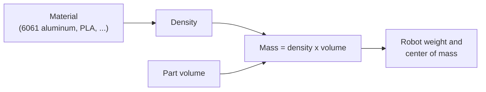
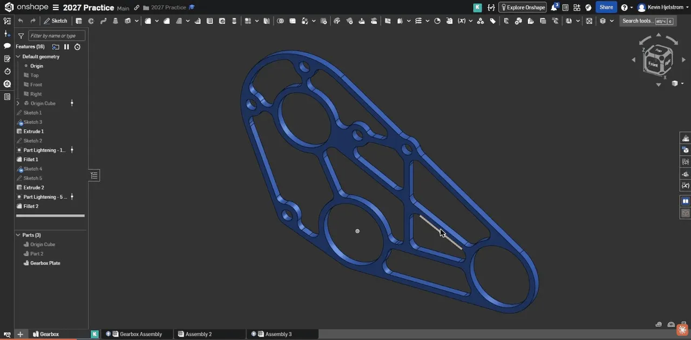
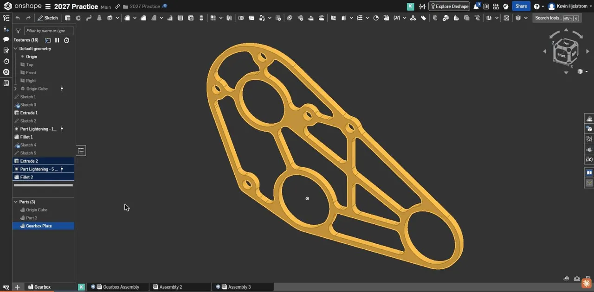
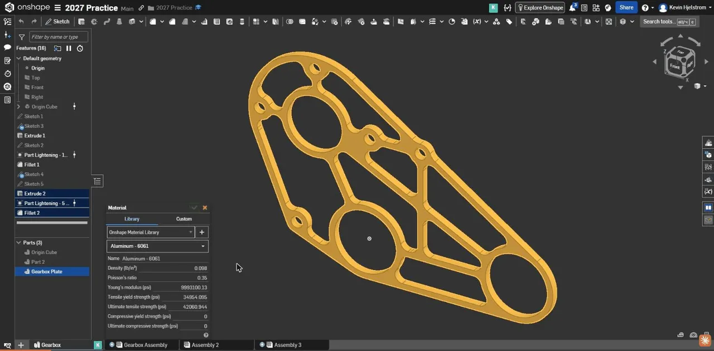
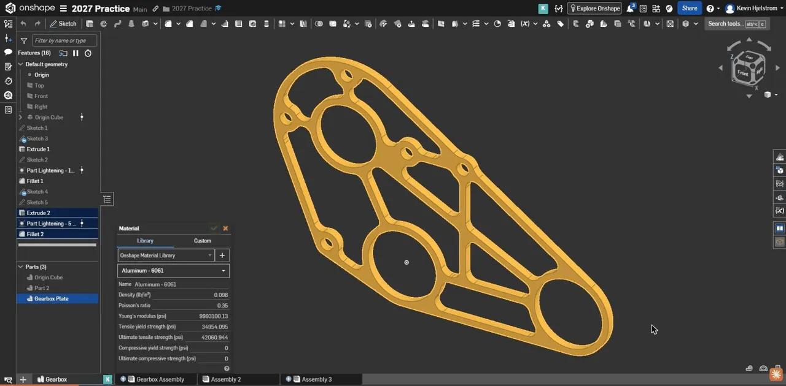

# Rule 6: Assign Real Materials Right Away

**The rule:** As soon as you create a new part, assign it the real material it will be made from. Do not wait until the design is finished.

## What it means

Every part in Onshape can have a **material**. The material gives the part a density, and Onshape multiplies density by the part's volume to get its mass. We want every part to carry the material it will really have on the robot, from the moment it exists.

Our materials:

| Material | Made by | Notes |
|---|---|---|
| 6061 aluminum | Machining | Our most common material. Pick it from the Onshape Material Library. |
| PLA | 3D printing | Printed parts also need an infill-aware mass (see How). |
| Nylon | 3D printing | Printed parts also need an infill-aware mass. |
| TPU | 3D printing | Printed parts also need an infill-aware mass. |
| Nylon | Machining | A machined Nylon part is solid, so density alone gives the right mass. |
| Polycarbonate | Machining | A machined polycarbonate part is solid too. |

Parts you insert from the FRC Design Library already have their correct masses assigned. Leave those alone.

## Why

- **Onshape ignores parts with no material.** A part without a material has no mass, so it adds nothing to the robot's weight or center of mass. A forgotten part makes the robot look lighter than it is. [Onshape's mass properties tool uses the density of the assigned material](https://cad.onshape.com/help/Content/massprops-ps.htm).
- **We find weight problems early.** The robot has a weight limit in the game manual. If every part has a real material, the running total is trustworthy all season, and we can fix an overweight design while it is still easy.
- **Center of mass matters.** A robot with a high or off-center center of mass tips and drives differently.
- **It is easy now and hard later.** Assigning a material takes seconds when you know what the part is. Doing 300 parts at the end means guessing, and some parts will get missed.
- **The bill of materials is right.** Materials also show up in assembly BOMs, so the same step helps ordering and machining.

## How

1. **Make the part.** As soon as an extrude or other feature creates a new part, move on to the next step before you do anything else.
2. **Right-click the part and choose Assign material.** Right-click it in the Parts list or in the graphics area. Select several parts first if they share a material.
3. **Pick from the library.** On the Library tab, choose a material library (the Onshape Material Library shows by default), then choose the material. Each material shows its density. Click the checkmark. For most machined parts, choose 6061 aluminum.
4. **For plastics, use the team's materials.** Pick PLA, Nylon, TPU or polycarbonate from our team material library once a mentor has set it up. If it is not there yet, use the **Custom** tab, type the material name and the density from our datasheet, and tell a mentor so it can be added. Always use the same names so parts are consistent.
5. **For 3D-printed parts, account for infill.** A printed part is not solid, so volume times plastic density overestimates the mass. Do one of these:
    - Use the **3D Printed Mass** FeatureScript (see [Getting Started](../getting-started.md)). It adjusts a printed part to a realistic mass from its material, infill and wall thickness.
    - Or take the mass from the slicer, open the **Mass properties** tool, select the part, check **Override**, and type the mass.
6. **Do it in bulk when you can.** Select a group of parts and assign once, or use the **Set Materials** FeatureScript to set materials and appearances for many parts at once.
7. **Check it.** Click the **Mass properties** icon in the bottom-right of the Part Studio or Assembly, select the **Part** tab, and click your parts. Every part should show a mass. If the tool shows nothing for a part, it has no material. In the assembly, check the robot's total mass and center of mass.
8. **Leave FRC Design Library parts alone.** They arrive with correct masses. Do not reassign them.

### Walkthrough (Gearbox Plate example)

Each clip below shows one step. Real screen-recorded videos will replace these as they are recorded (see [how to add a video](../videos/README.md)).

#### Step 1: Find the new part in the Parts list

It appears there as soon as it is created.

#### Step 2: Right-click the part and choose Assign material

!!! tip
    If the part already has a material, the menu says **Edit material** instead. It opens the same dialog.

#### Step 3: Pick the material from the library

On the Library tab, search for 6061, pick **Aluminum - 6061**, then click the green check.

#### Step 4: Check the mass in Mass properties

Open **Mass properties** and click the part. It now shows a mass (0.046 lb here).

### Common mistakes

- Leaving parts at the default with no material "to do later."
- Assigning aluminum to a part that will be 3D printed.
- Assigning a plastic to a printed part and ignoring infill.
- Reassigning masses on parts that came from the FRC Design Library.
- Typing a slightly different density on each part instead of using one team material.

### More to read

- [Onshape: customizing part materials](https://cad.onshape.com/help/Content/PartStudio/customizing_part_materials.htm)
- [Onshape: mass properties tool](https://cad.onshape.com/help/Content/View/mass_properties_tool.htm)
- [Onshape: material libraries](https://cad.onshape.com/help/Content/material_library.htm), including how to make a team library from a spreadsheet
- [FeatureScripts list: 3D Printed Mass and Set Materials](https://frcdesign.org/resources/featurescripts/)
